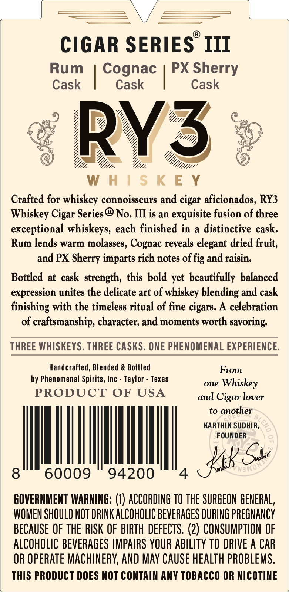
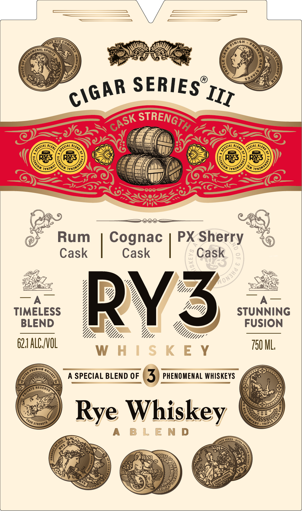

# TTB COLA Label Images - TTBID 26294001000679

**Brand Name:** RY3 WHISKEY

**Fanciful Name:** CIGAR SERIES III

**Issue Date:** 11/06/2026

**Origin Code:** 44

**Product Class/Type:** 132

**Source:** [TTB Public COLA Registry](https://ttbonline.gov/colasonline/viewColaDetails.do?action=publicFormDisplay&ttbid=26294001000679)

## Label Images

### Back Label

### Label 1

## Extracted Label Text

*Text extracted via OCR - may contain errors*

### Back Label

CIGAR SERIES III
Rum
Cognac
PX Sherry
Cask
Cask
Cask
RY3
W H | $ K E Y
Crafted for whiskey connoisseurs and cigar aficionados, RY3
Whiskey Cigar Series
No. III is an
exquisite fusion of three
exceptional whiskeys, each finished in
a
distinctive cask.
Rum lends warm molasses, Cognac reveals elegant dried fruit,
and PX Sherry imparts rich notes of fig and raisin:
Bottled at cask strength, this bold yet beautifully balanced
expression unites the delicate art of whiskey blending and cask
finishing with the timeless ritual of fine cigars. A celebration
of craftsmanship, character; and moments worth savoring;
THREE WHISKEYS. THREE CASKS. ONE PHENOMENAL EXPERIENCE:
Handcrafted, Blended & Bottled
From
by Phenomenal Spirits, Inc
Taylor
Texas
one
Whiskey
PRODUCT
OF USA
and Cigar lover
to another
KARTHIK SUDHIR;
FOU NDER
KK Ss
8
60009
94200
GOVERNMENT WARNING:
1) ACCORDING TO the SURGEON GENERAL,
WOMEN SHOULD NOT DRINK ALCOHOLIC BEVERAGES DURING PREGNANCY
BECAUSE OF THE RISK OF BIRTH DEFECTS, (2) CONSUMPTION OF
ALCOHOLIC BEVERAGES IMPAIRS YOUR ABILITY TO DRIVE A CAR
OR Operate MACHINERY; AND MAY CAUSE HeALTh PROBLeMS;
ThIS PRODUCT DOES NOT CONTAIN ANY TOBACCO OR NICOTINE
In
5
'Nawo

### Label 1

SERIES
Rum
Cognac
PX Sherry
Cask
Cask
Cask
TIMELESS
RY3
STUNNING
BLEND
FUSION
62.1 ALCIVOL
750 ML,
W H | $ K E Y
A SPECIAL BLEND OF
3
PHENOMENAL WHISKEYS
Whiskey
960
Trip
B L E N D
CIGAR
III
STRENGTH
CASK
ECial
Ial
Y0NJH€
Rye
