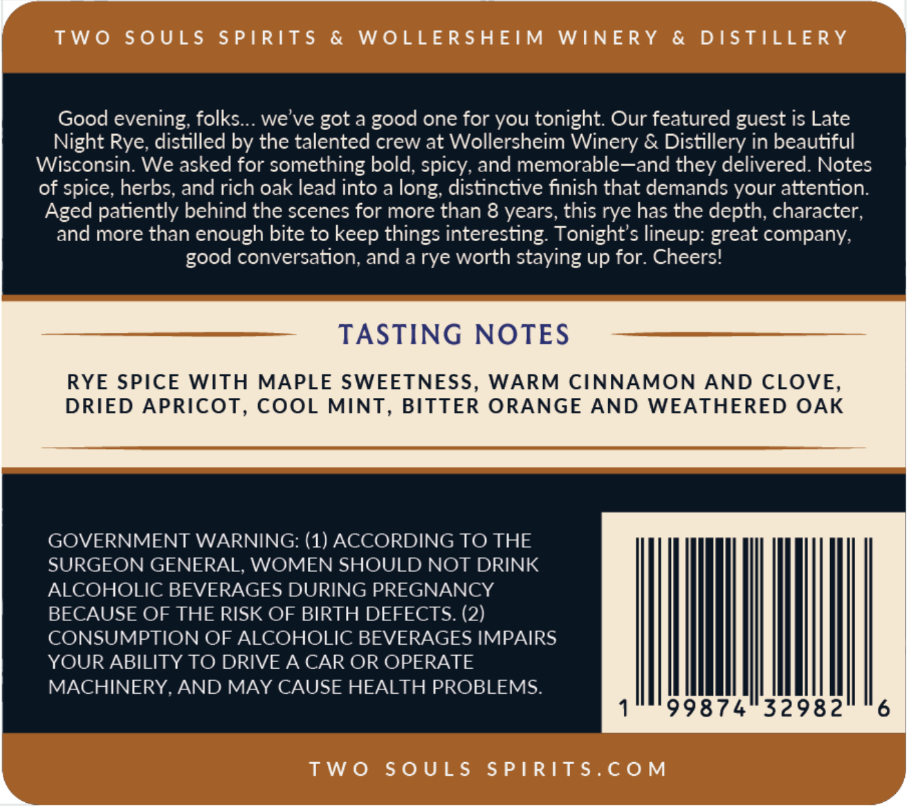
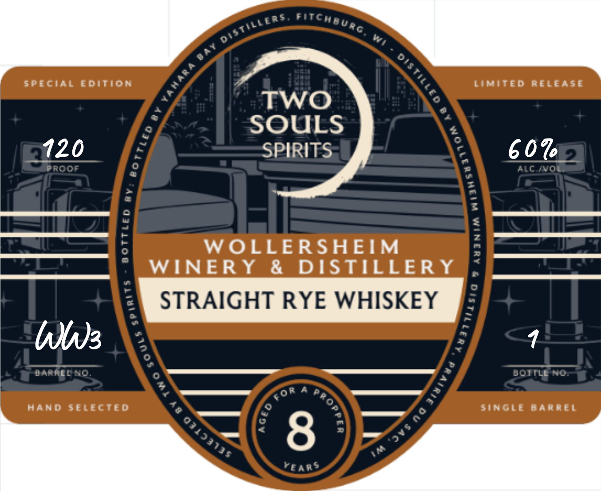

# TTB COLA Label Images - TTBID 26294001000698

**Brand Name:** TWO SOULS

**Issue Date:** 10/23/2026

**Origin Code:** 48

**Product Class/Type:** 102

**Source:** [TTB Public COLA Registry](https://ttbonline.gov/colasonline/viewColaDetails.do?action=publicFormDisplay&ttbid=26294001000698)

## Label Images

### Back Label

### Label 1

## Extracted Label Text

*Text extracted via OCR - may contain errors*

**Detected Age:** 8 Years

### Back Label

TWO SOULS SPIRITS & WOLLERSHEIM WINERY & DISTILLERY

Good evening, folks... we've got a good one for you tonight. Our featured guest is Late

Night Rye, distilled by the talented crew at Wollersheim Winery & Distillery in beautiful

Wisconsin. We asked for something bold, spicy, and memorable—and they delivered. Notes

of spice, herbs, and rich oak lead into a long, distinctive finish that demands your attention.

Aged patiently behind the scenes for more than 8 years, this rye has the depth, character,

and more than enough bite to keep things interesting. Tonight’s lineup: great company,

good conversation, and a rye worth staying up for. Cheers!

TASTING NOTES

RYE SPICE WITH MAPLE SWEETNESS, WARM CINNAMON AND CLOVE,

DRIED APRICOT, COOL MINT, BITTER ORANGE AND WEATHERED OAK

GOVERNMENT WARNING: (1) ACCORDING TO THE

SURGEON GENERAL, WOMEN SHOULD NOT DRINK

ALCOHOLIC BEVERAGES DURING PREGNANCY

BECAUSE OF THE RISK OF BIRTH DEFECTS. (2)

CONSUMPTION OF ALCOHOLIC BEVERAGES IMPAIRS

YOUR ABILITY TO DRIVE A CAR OR OPERATE

MACHINERY, AND MAY CAUSE HEALTH PROBLEMS.

IMM

TWO SOULS SPIRITS.COM

### Label 1

F
Special
Eoition
Limited
RELEASE
TwO
SOULS
120
SPIRITS
607 3
Prooe
AC N0
6
1
WOLLERSHEIM
1
WINER Y
&
DISTILLERY
p
STRAIGHT RYE WHISKEY
6
Wug
DaaRLDCO
BOITLL No
Hand
selegted
SinGLe
BaRREL
8
Mears
Fitcmaurc
distiliers,
M
0a7
8
1
1
6
"
1
1
1
1

3
8
1
Tor
1
6
3
8
0,158135
3v$
JM
