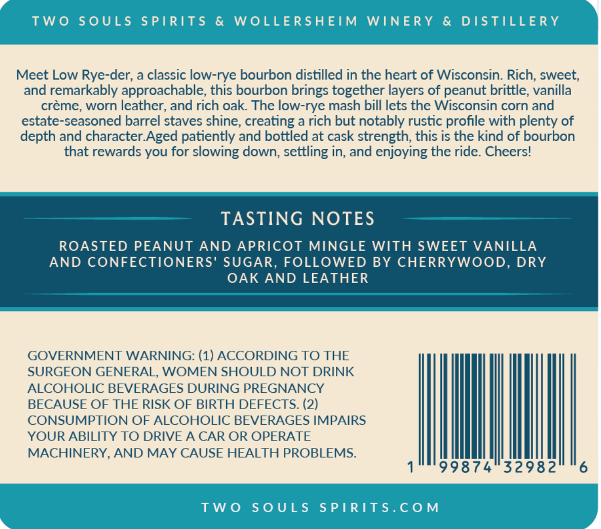
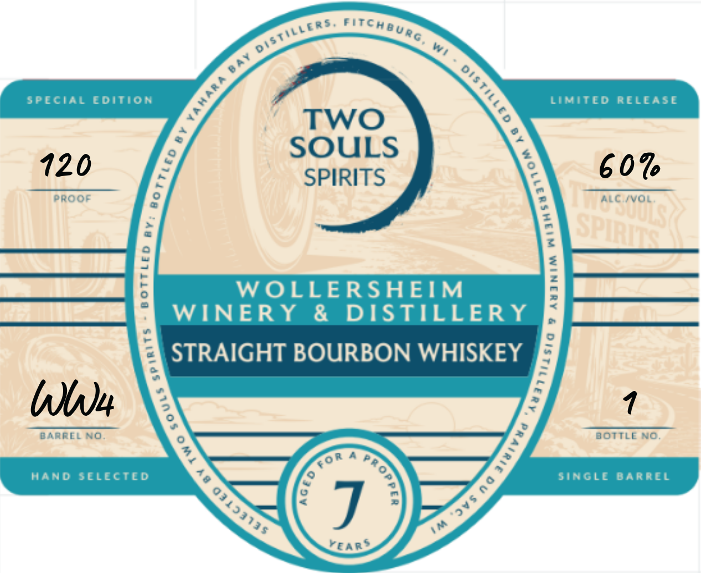

# TTB COLA Label Images - TTBID 26294001000700

**Brand Name:** TWO SOULS

**Issue Date:** 10/23/2026

**Origin Code:** 48

**Product Class/Type:** 101

**Source:** [TTB Public COLA Registry](https://ttbonline.gov/colasonline/viewColaDetails.do?action=publicFormDisplay&ttbid=26294001000700)

## Label Images

### Back Label

### Label 1

## Extracted Label Text

*Text extracted via OCR - may contain errors*

### Back Label

TW0
S0ULS
SPIRITS
&
WOLLERSHEIM
WINERY
&
DISTILLERY
Meet Low Rye-der; a classic low-rye bourbon distilled in the heart of Wisconsin: Rich; sweet;
and remarkably approachable; this bourbon brings together layers of peanut brittle; vanilla
creme; worn leather; and rich oak: The low-rye mash bill lets the Wisconsin corn and
estate-seasoned barrel staves shine; creating a rich but notably rustic profile with plenty of
depth and character Aged patiently and bottled at cask strength; this is the kind of bourbon
that rewards
for slowing down, settling in; and enjoying the ride: Cheers!
TASTING NOTES
ROASTED PEANUT
AND APRICOT MINGLE WITH SWEET VANILLA
AND CONFECTIONERS' SUGAR, FOLLOWED BY CHERRYWOOD,
DRY
OAK AND LEATHER
GOVERNMENT WARNING: (1) ACCORDING TO THE
SURGEON GENERAL; WOMEN SHOULD NOT DRINK
ALCOHOLIC BEVERAGES DURING PREGNANCY
BECAUSE OF THE RISK OF BIRTH DEFECTS. (2)
CONSUMPTION OF ALCOHOLIC BEVERAGES IMPAIRS
YOUR ABILITY TO DRIVE A CAR OR OPERATE
MACHINERY, AND MAY CAUSE HEALTH PROBLEMS:
99874
32982
6
TW0
S0 ULS
S PIRITS.C0M
you

### Label 1

st

veers wr cHeug

Wy,

PECIAL EDITION

LIMITED RELEASE

TWO

SOULS

SPIRITS

WOLLERSHEIM

WINERY & DISTILLERY

STRAIGHT BOURBON WHISKEY

bn

BARREL NO

BOTTLE

ROR A 2

HAND SELECTED

4

SINGLE BARREL

%

75

Pr, °

AS

rear?
