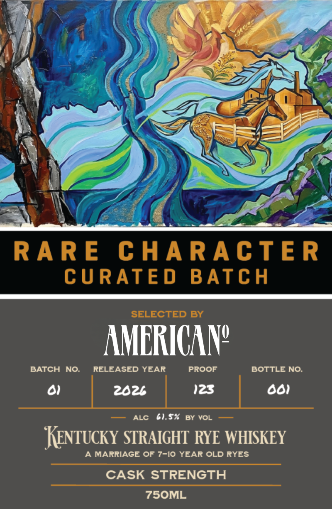
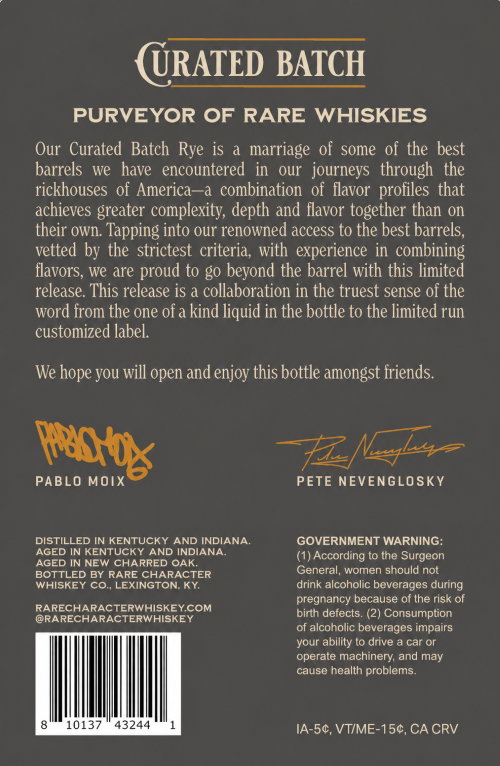

# TTB COLA Label Images - TTBID 26294001000706

**Brand Name:** RARE CHARACTER

**Issue Date:** 10/26/2026

**Origin Code:** 22

**Product Class/Type:** 101

**Source:** [TTB Public COLA Registry](https://ttbonline.gov/colasonline/viewColaDetails.do?action=publicFormDisplay&ttbid=26294001000706)

## Label Images

### Front Label

### Label 2

### Label 3

## Extracted Label Text

*Text extracted via OCR - may contain errors*

*1 image(s) excluded: text did not meet readability threshold*

**Detected Age:** 10 Years

### Front Label

RARE
C HARACTE R
CURATE D
BATCH
SELECTED BY
AMERICAN?
BATCH
NO.
RELEASED YEAR
PROOF
BOTTLE NO:
0
202t
123
801
ALC
61.57
BY VOL
KenTucky STRAIGHT RYE WHISKEY
A MARRIAGE OF 7-10 YEAR OLD RYES
CASK STRENGTH
75OML

### Label 3

URATED BATCH
PURVEYOR OF RARE WHISKIES
Our  Curated Batch Rye is
marriage of some of the best
barrels
we   have
encountered
our   journeys   through the
rickhouses of America-a combination
of flavor profiles that
achieves greater complexity; depth and flavor together than on
their own.
Tapping into our renowned access to the best barrels;
vetted by the strictest criteria; with experience in  combining
flavors; we are proud to go beyond the barrel with this limited
release. This release is & collaboration in the truest sense of the
word from the one of
kind liquid in the bottle to the limited run
customized label.
We
you will open
enjoy this bottle amongst friends.
PABLO MOIX
PETE NEVENGLOSKY
DISTILLED IN KENTUCKY AND INDIANA.
GOVERNMENT WARNING:
AGED IN KENTUCKY AND INDIANA
(1) According to the Surgeon
IN NEW CHARRED
La
BOTTLED BY RARE CHARACTER
General, women should not
WHISKEY co, LEXINGTON KY
drink alcoholic beverages during
pregnancy because of the risk of
RARECHARACTERWHISKEYCOM
birth defects. (2) Consumption
@RARECHARACTERWHISKEY
of alcoholic beverages
your ability
drive
car Or
operate machinery; and may
cause health problems:
10137
43744
IA-54,VTIME-150,CA CRV
hope `
and
psb
AGED
impaits
