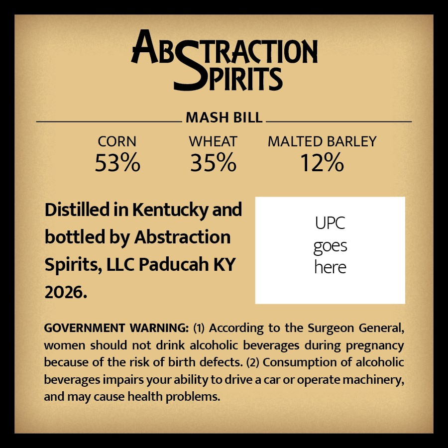
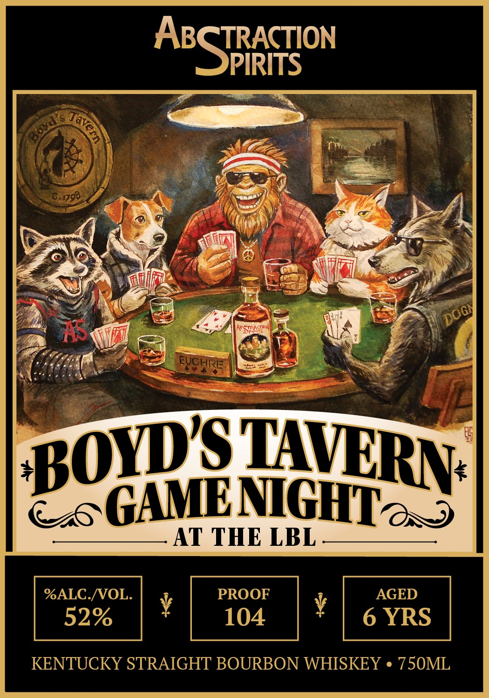

# TTB COLA Label Images - TTBID 26294001000755

**Brand Name:** ABSTRACTION SPIRITS

**Fanciful Name:** BOYD'S TAVERN GAME NIGHT AT THE LBL

**Issue Date:** 10/26/2026

**Origin Code:** 22

**Product Class/Type:** 101

**Source:** [TTB Public COLA Registry](https://ttbonline.gov/colasonline/viewColaDetails.do?action=publicFormDisplay&ttbid=26294001000755)

## Label Images

### Back Label

### Front Label

## Extracted Label Text

*Text extracted via OCR - may contain errors*

**Detected Proof:** 106
**Detected Age:** 6 Years

### Back Label

TRACTION

ABS

PIRITS

MASH BILL

CORN

WHEAT

MALTED BARLEY

53%

35%

12%

Distilled in Kentucky and

UPC

bottled by Abstraction

goes

Spirits, LLC Paducah KY

here

2026.

GOVERNMENT WARNING: (1) According to the Surgeon General,

women should not drink alcoholic beverages during pregnancy

because of the risk of birth defects. (2) Consumption of alcoholic

beverages impairs your ability to drive a car or operate machinery,

and may cause health problems.

### Front Label

AESFiron
9798
AS
'Seacon
FUCHRE.
GANENGHTas
AT THE LBL
%ALC-NOL.
PROOF
AGED
52%
104
6 YRS
KENTUCKY STRAIGHT BOURBON WHISKEY
750ML
javern
DOGY
BOYDST
TAVRN
