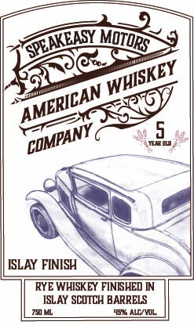

# TTB COLA Label Images - TTBID 26294001000760

**Brand Name:** SPEAKEASY MOTORS AMERICAN WHISKEY COMPANY

**Fanciful Name:** ISLAY FINISH

**Issue Date:** 10/27/2026

**Origin Code:** 02

**Product Class/Type:** 142

**Source:** [TTB Public COLA Registry](https://ttbonline.gov/colasonline/viewColaDetails.do?action=publicFormDisplay&ttbid=26294001000760)

## Label Images

### Label 1

### Label 2

## Extracted Label Text

*Text extracted via OCR - may contain errors*

### Label 1

Sam

OTURs

SEY

we

ad

Eg

ISLAY FINISH

RYE WHISKEY FINISHED IN

mnt SUITE BARRELS

### Label 2

AT SPEAKEASY MdtdRS CRAFTSMANSHIP AND CREATMITY ARE THE @RIVING FDRCES: WHEN
WE DELAM PRMDUCINE
SPIRLTS THIS SAME COMAMALTMENT TD QualITY REMAINEL
INSIDE EACH BDTTLE youll FIND SPIRITS MADE FROM LoCaLlY SDURCED NEW YORK GRAING
EVERY BLEND
BARRELS
CAREFULLY LURATED BY US INSMALL BATCHES TD CREATE
DELILLDUS Pdur FOR Yol
Breakeady
WWW speakeasymotorswhiskeyco.com
Distilled in New York Produced by Gardiner Liquid Mercantile Pine Bush; NY
GOVERNMENT E
ARNING: (I) According to the Surgeon General women should
not drink alcoholic beverages during pregnancy because of the nsk ofbirth defects;
(21 Consumption of alcoholic beverages impairs your ability
drive
operate
machineny and may cause health problems:
Aeasy
0
(
Whiskey `
