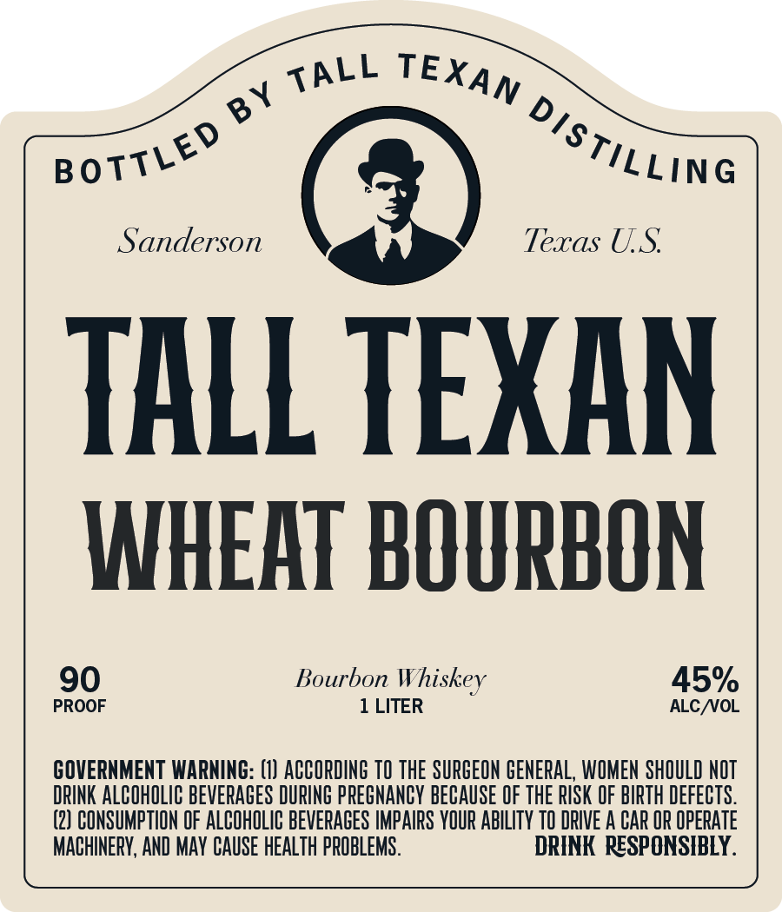

# TTB COLA Label Images - TTBID 26294001000769

**Brand Name:** TALL TEXAN WHEAT BOURBON

**Issue Date:** 10/26/2026

**Origin Code:** 44

**Product Class/Type:** 141

**Source:** [TTB Public COLA Registry](https://ttbonline.gov/colasonline/viewColaDetails.do?action=publicFormDisplay&ttbid=26294001000769)

## Label Images

### Label 1

## Extracted Label Text

*Text extracted via OCR - may contain errors*

**Detected Proof:** 90

### Label 1

Sanderson
Texas US
TALL TEXAN
WHEAT BOURBON
90
Bourbon
Whiskey
45%
PROOF
1 LITER
ALC NOL
GOVERNMENT WARNING: (1) ACCOPDING TO THE SURGEON GENERAL, WOMEN SHOULD NOT
DRINK ALCOHOLIC BEVERAGES DURING PPEGNANCY BECAUSE OF ThE RISK OF BITH deFECTS.
(2) CONSUMPTION OF ALCOHOLIC BEVERAGES IMPAIPS YOUR ABILITY TO DRIVE A CAR OR OpeRATE
MACHINERV, AND MAV CAUSE HEALTH PROBLEMS .
DRINK   RESPONSIBLY.
TALL
TEXAN
BY
distiLLing
BOTTLED
