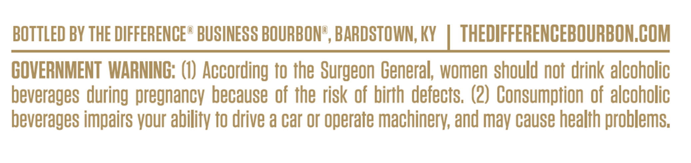
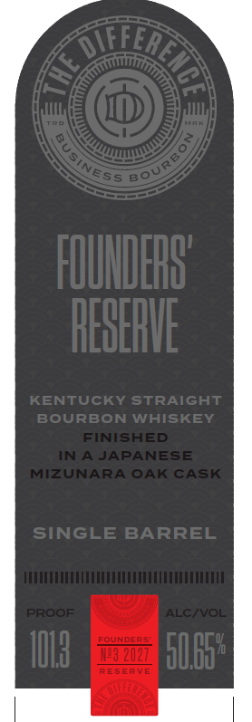
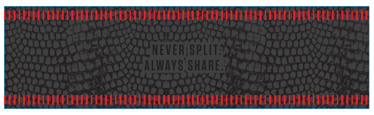

# TTB COLA Label Images - TTBID 26295001000113

**Brand Name:** THE DIFFERENCE BUSINESS BOURBON

**Issue Date:** 10/26/2026

**Origin Code:** 22

**Product Class/Type:** 101

**Source:** [TTB Public COLA Registry](https://ttbonline.gov/colasonline/viewColaDetails.do?action=publicFormDisplay&ttbid=26295001000113)

## Label Images

### Back Label

### Label 1

### Label 2

## Extracted Label Text

*Text extracted via OCR - may contain errors*

*1 image(s) excluded: text did not meet readability threshold*

### Back Label

BOTTLED BY THE DIFFERENCE e BUSINESS BOURBONe, BARDSTOWN; KY
THEDIFFERENCEBOURBONCOM
COVERNMENT WARNING: (0) According to the Surgeon General; women should nof drink alcoholic
beverages during pregnancv because of the risk of birth defects. (2) Consumption of alcoholic
beverages impairs vour ability to drive a car or operate machinery; and may cause health problems;

### Label 1

IFFER
BO
FOUHDERB'
REBERUE
KENTUCKY StRaiGHT
BOURBON
WHISKEY
FINISHED
N
AJAPANESE
MIZUNARA OAK CASK
SINGLE BARREL
PROOF
ALC NOL
FOURDERS
IO8
12027
SUB5"
RESERVE
3
