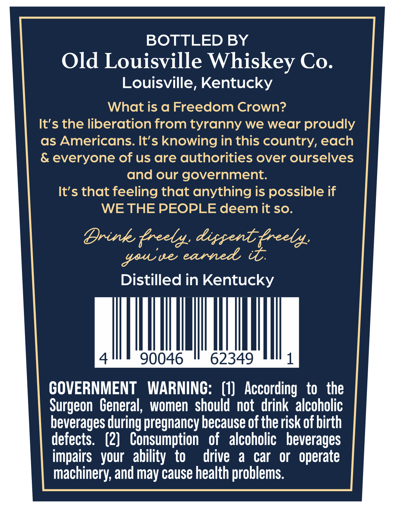
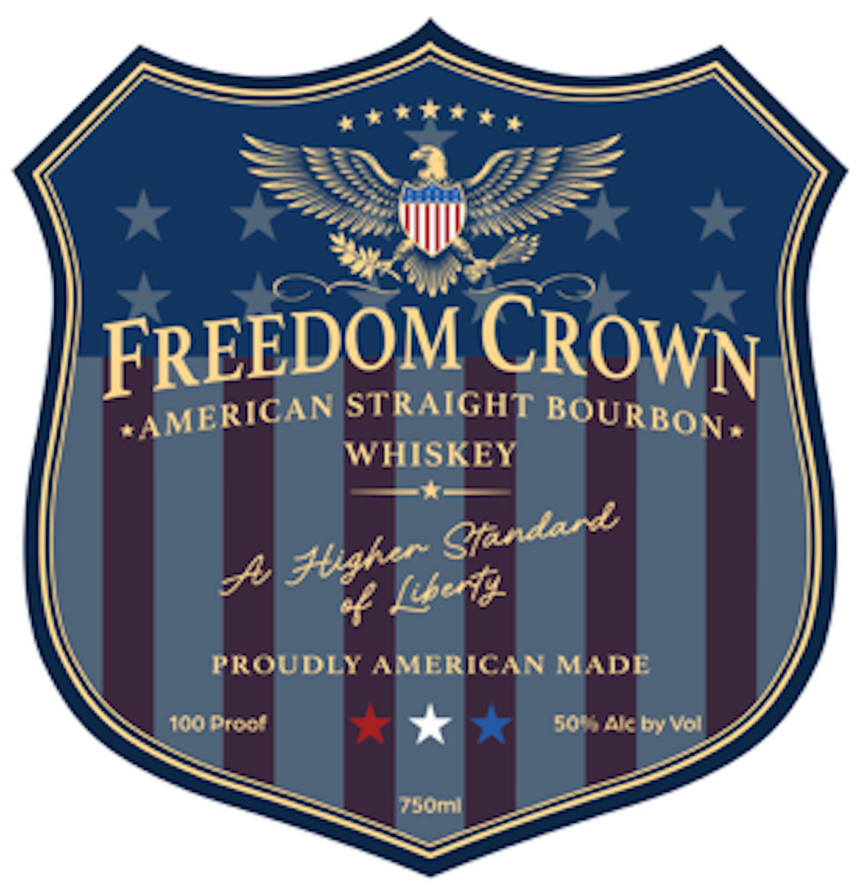

# TTB COLA Label Images - TTBID 26295001000140

**Brand Name:** FREEDOM CROWN

**Issue Date:** 10/27/2026

**Origin Code:** 22

**Product Class/Type:** 101

**Source:** [TTB Public COLA Registry](https://ttbonline.gov/colasonline/viewColaDetails.do?action=publicFormDisplay&ttbid=26295001000140)

## Label Images

### Back Label

### Front Label

## Extracted Label Text

*Text extracted via OCR - may contain errors*

### Back Label

BOTTLED BY
Old Louisville Whiskey Co.
Louisville, Kentucky
What is a Freedom Crown?
It's the liberation from tyranny we wear proudly
as Americans. It's knowing in this country, each
& everyone of us are authorities over ourselves
and our government:
It's that feeling that anything is possible if
WE THE PEOPLE deem it so.
Drink {reely: dippent;
ue eanned
Distilled in Kentucky
90046
62349
GOVERNMENT
WARNING:   (1)   According   to   the
Surgeon  General, women  should not  drink' alcoholic
beverages during pregnancy because of the risk of birth
defects.   (2}   Consumption
of  alcoholic   beverages
impairs   your   ability  to
drive
a
car
or   operate
machinery, and may cause health problems.
Zreel
Yau; [

### Front Label

FREEDOM
STRAIGHT
WHISKEY
PROUDLY AMERICAN MADE
100 Prev
505ak by Vol
Tsomni
CROWN
#AMERICAN
BOURBON.
Gfandard
5 304[480
