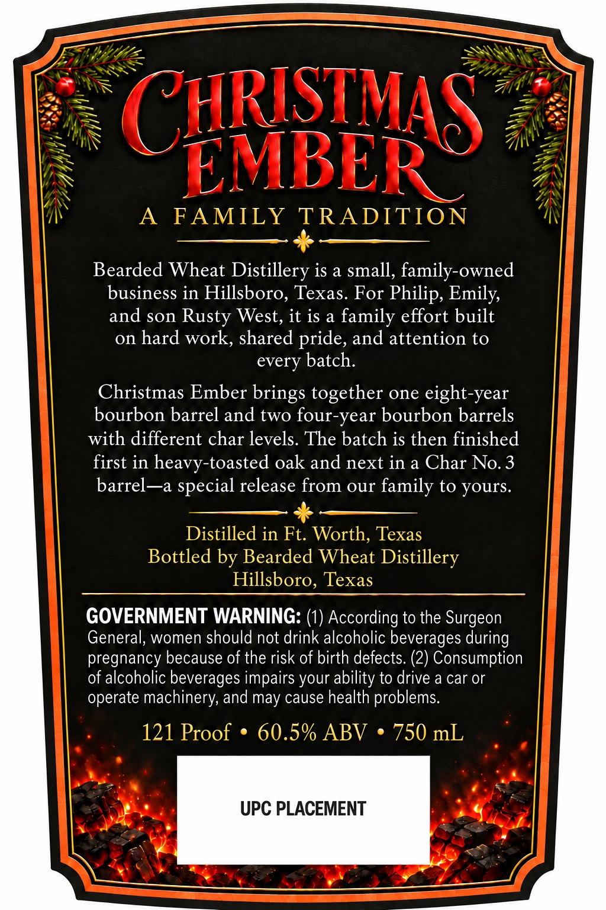
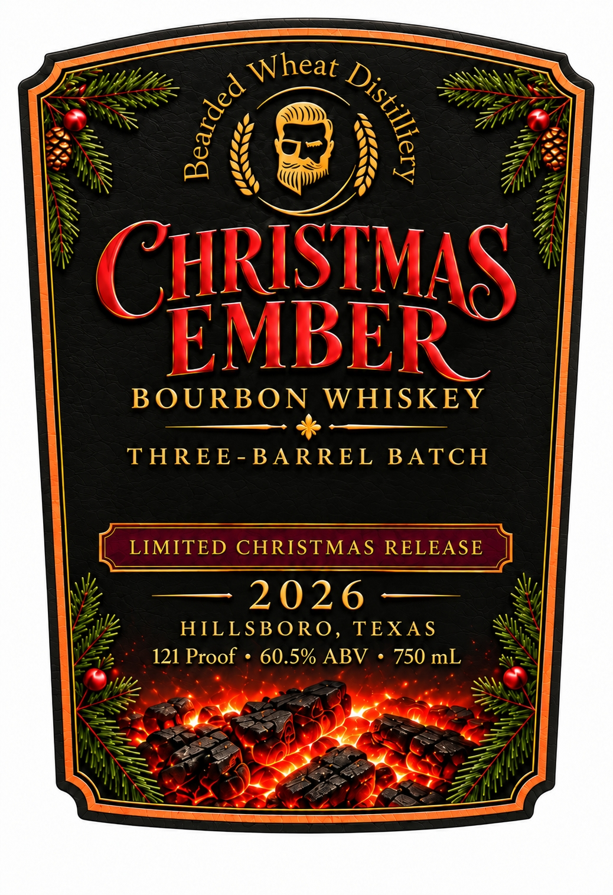

# TTB COLA Label Images - TTBID 26295001000156

**Brand Name:** CHRISTMAS EMBER BOURBON WHISKEY

**Issue Date:** 10/28/2026

**Origin Code:** 44

**Product Class/Type:** 101

**Source:** [TTB Public COLA Registry](https://ttbonline.gov/colasonline/viewColaDetails.do?action=publicFormDisplay&ttbid=26295001000156)

## Label Images

### Back Label

### Front Label

## Extracted Label Text

*Text extracted via OCR - may contain errors*

**Detected Proof:** 121

### Back Label

CHRISTMAS
EMBERC
A
FAMILY
TRADITION
Bearded Wheat Distillery is a small, family-owned
business in Hillsboro, Texas. For Philip, Emily,
and son Rusty West, it is a family effort built
on hard work, shared pride, and attention to
every batch:
Christmas Ember brings together one eight-year
bourbon barrel and two four-year bourbon barrels
with different char levels. The batch is then finished
first in heavy-toasted oak and next in a Char No.3
barrel--a
special release from our family to yours.
Distilled in Ft: Worth; Texas
Bottled by Bearded Wheat Distillery
Hillsboro, Texas
GOVERNMENT WARNING: (1) According to the Surgeon
General, women should not drink alcoholic beverages during
pregnancy because of the risk of birth defects: (2) Consumption
of alcoholic beverages impairs your ability to drive a car or
operate machinery, and may cause health problems:
121 Proof
60.5% ABV
750 mL
UPC PLACEMENT

### Front Label

Wheat
(CHRISTMAS
EMBER
BOURB ON
WHISKE Y
THREE- BARREL
BATCH
LIMITED CHRISTMAS
RELEASE
2026
HILLSB ORO,
TEXA S
121 Proof
60.5% ABV
750 mL
)
7
