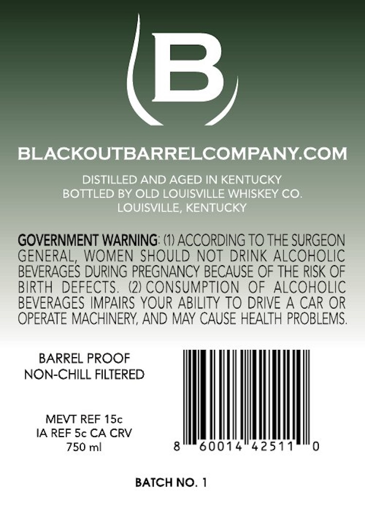
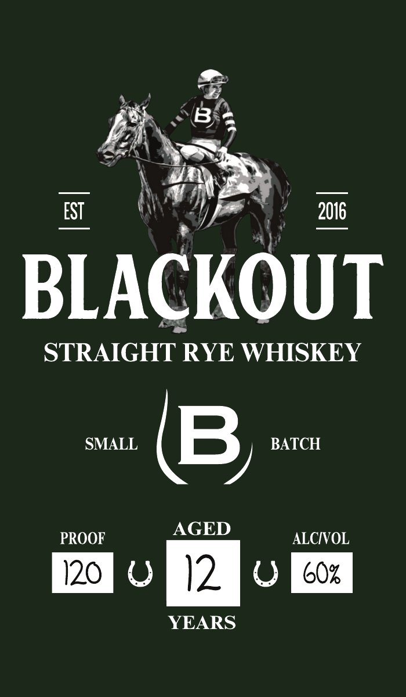

# TTB COLA Label Images - TTBID 26295001000164

**Brand Name:** BLACKOUT

**Issue Date:** 10/26/2026

**Origin Code:** 22

**Product Class/Type:** 102

**Source:** [TTB Public COLA Registry](https://ttbonline.gov/colasonline/viewColaDetails.do?action=publicFormDisplay&ttbid=26295001000164)

## Label Images

### Back Label

### Front Label

## Extracted Label Text

*Text extracted via OCR - may contain errors*

### Back Label

B
BLACKOUTBARRELCOMPANYCOM
DISTILLED AND AGED IN KENTUCKY
BOTTLED BY OLD LOUISVILLE WHISKEY CO_
LOUISVILLE, KENTUCKY
GOVERNMENT WARNING: (1) ACCORDING TO THE SURGEON
GENERAL, WOMEN SHOULD NOT DRINK ALCOHOLIC
BEVERAGES DURING PREGNANCY BECAUSE OF THE RISK OF
BIRTH
DEFECTS.
(2) CONSUMPTION
OF ALCOHOLIC
BEVERAGES IMPAIRS YOUR ABILITY TO DRIVE A CAR OR
OPERATE MACHINERY, AND MAY CAUSE HEALTH PROBLEMS:
BARREL PROOF
NON-CHILL FILTERED
MEVT REF 15c
IA REF Sc CA CRV
750 ml
8
60014
42511
0
BATCH NO.

### Front Label

EST
2016
BLACKOUT
STRAIGHT RYE WHISKEY
SMALL
B
BATCH
AGED
PROOF
ALCIVOL
120
12
607
YEARS
