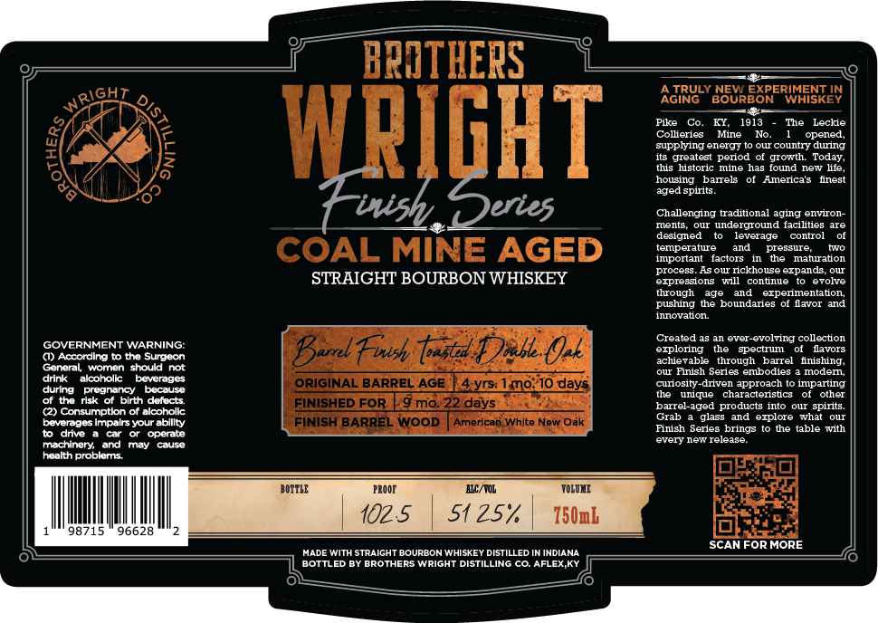

# TTB COLA Label Images - TTBID 26295001000228

**Brand Name:** BROTHERS WRIGHT

**Fanciful Name:** TOASTED DOUBLE OAK BARREL FINISH

**Issue Date:** 10/29/2026

**Origin Code:** 22

**Product Class/Type:** 101

**Source:** [TTB Public COLA Registry](https://ttbonline.gov/colasonline/viewColaDetails.do?action=publicFormDisplay&ttbid=26295001000228)

## Label Images

### Label 1

## Extracted Label Text

*Text extracted via OCR - may contain errors*

### Label 1

BRATHERS
AGIRU
JRULY BOUREORE
EORERIMESKEN
Pike
1913
The
Leckie
WpIGHT
Sopeying eneIge
Olr countr-? denradg_
Clealest
period of growth
Today,
JuSTOric
Ime has
[oucL
new
housing
banels
Amnerica:
nest
spirits
{Fwish Deries
Challenging traditional aging environ-
ments
underground facilities are
designed
leverage
control
COAL MINE AGED
tenperatue
and
Phessuaturation
Iponant
factors
process
Asou rickhouse erpands
STRAIGHT BOURBON WHISKEY
ezpressions
will
Contnie
0707e
tlough
exvenlentaton
pushing the boundares
lavor and
Tnnotaton
Created a8
ever-evolving collection
GONERNInENO WARNING;
Barat Fwsh tastd Dahe Oak
eISOnle
Sectrul
Havore
vable
through
barrel    fnishing_
General woman should
Finish Series
soores
Ioden
drink
akcoholic
Devemdes
ORIGINAL BARREL AGE
4rs 1mo*10 days
cunosll-
drven approach
mparting
during
pregnancy
Daause
uiucMe
charactensucs
oter
of the risk of
birth defects
FINISHED FOR
9 mo22 days
barrel-aged products into
our spirits.
(2) Consumptkon of alcoholk
beverages impalrsyour ablllty
FINISH BARREL WOOD
American White New Oak
Grab
glass
ezplore what our
drive
operate
Finish Series brings
the table with
every new release
machinery:
and
may
cause
health problems
BOITLE
PROOF
MIC/ ROL
TOLOLE
102.5
51 257
750mb
98715
96628
SCANFORMORE
HADE With StraIGHT BOURBON WHISKEY DISTILLED IN INDIANA
BOTILED BY BROTHERS WrIGHT DISTILLING co. AFLEX KY
WRIGHT
0
3
Fs
ged
Jcle
