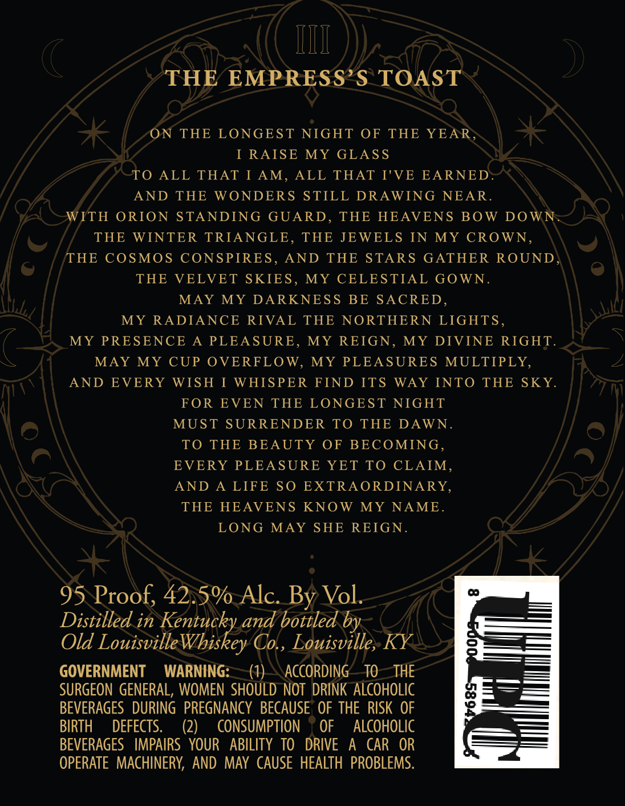
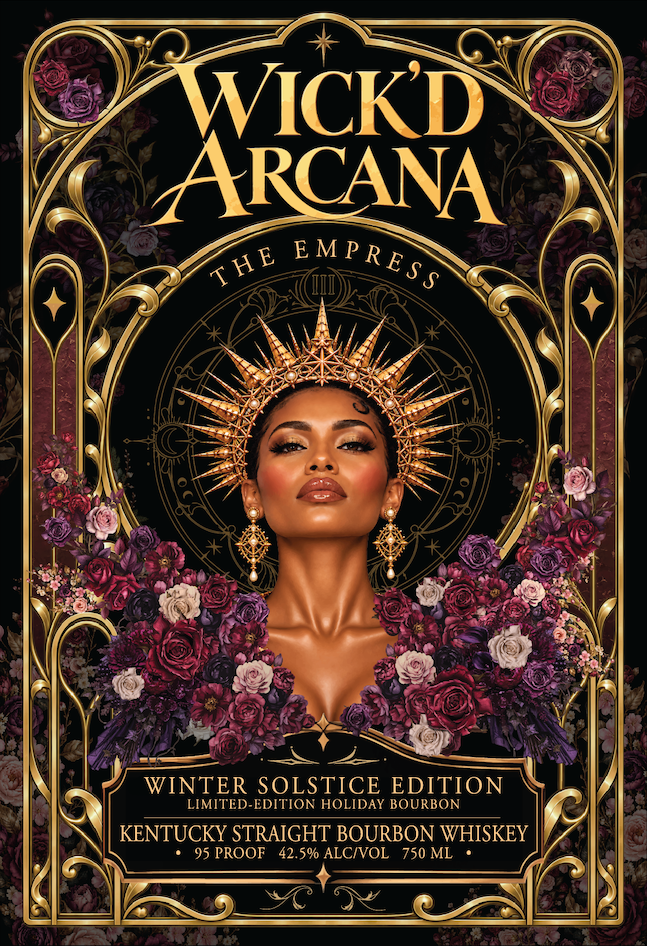

# TTB COLA Label Images - TTBID 26295001000272

**Brand Name:** WICK'D ARCANA

**Issue Date:** 10/26/2026

**Origin Code:** 22

**Product Class/Type:** 101

**Source:** [TTB Public COLA Registry](https://ttbonline.gov/colasonline/viewColaDetails.do?action=publicFormDisplay&ttbid=26295001000272)

## Label Images

### Back Label

### Front Label

### Label 3

## Extracted Label Text

*Text extracted via OCR - may contain errors*

**Detected Proof:** 95

### Back Label

III
THE EMPRESS'$ TOAST
ON
THE
LONGEST NIGHT OF
THE
YEAR
I RAISE
MY
GLAS S
To
ALL THAT I AM,
ALL THAT T'VE EARNED
AND
THE
WONDERS
STILL DRAWING
NEAR_
WITH ORION
STANDING
GUARD ,
THE
HEAVENS
BOW DOWN
THE WINTER TRIANGLE ,
THE JEWELS IN
MY CROWN,
THE
COSMOS CONSPIRES,
AND THE STARS GATHER
ROUND
THE
VELVET SKIES
MY
CELESTIAL GOWN_
MAY
MY DARKNES S
BE SACRED
MY RADIANCE
RIVAL
THE NORTHERN
LIGHTS_
MY
PRESENCE
PLEASURE ,
MY
REIGN,
MY
DIVINE RIGHT
MAY MY
CUP OVERFLOW,
MY PLEASURES MULTIPLY,
AND
EVERY
WISH
I WHISPER FIND ITS
WAY
INTO THE SKY.
FOR
EVEN THE LONGEST NIGHT
MUST SURRENDER
TO THE
DAWN _
TO THE BEAUTY
OF BECOMING ,
EVERY PLEASURE YET TO
CLAIM,
AND
LIFE SO
EXTRAORDINARY
THE HEAVENS KNOW
MY
NAME _
LONG
MAY SHE REIGN.
95 Proof; 42.5% Alc: By Vol
Distilled in Kentucky and bottled by
Old Louisville"
Whiskey Co
Louisville, KY
GOVERNMENT
WARNING:
ACCORDING
TO
THE
SURGEON  GENERAL, WOMEN  SHOULD NOT  DRINK ALCOHOLIC
BEVERAGES   DURING  PREGNANCY BECAUSE   OF THE RISK OF
BIRTH
DEFECTS.
(2)
CONSUMPTION
OF
ALCOHOLIC
BEVERAGES   IMPAIRS   YOUR
ABILITY TO
DRIVE
A
CAR   OR
OPERATE  MACHINERY,  AND MAY CAUSE  HEALTH  PROBLEMS.

### Front Label

WICKD
ARCANA
WINTER SOLSTICE EDITION
LIMITED-EDITION HOLIDAY BOURBON
KENTUCKY STRAIGHT BOURBON WHISKEY
95 PROOF
42.5% ALCIVOL   750 ML
E M P R E $ $
THE

### Label 3

,

L

ail

ssawawa

EMPRESS

BS mece

PPP
