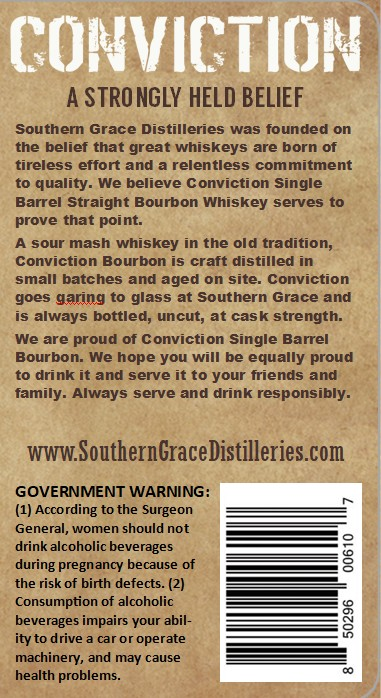
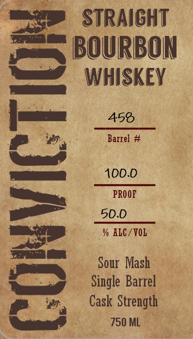
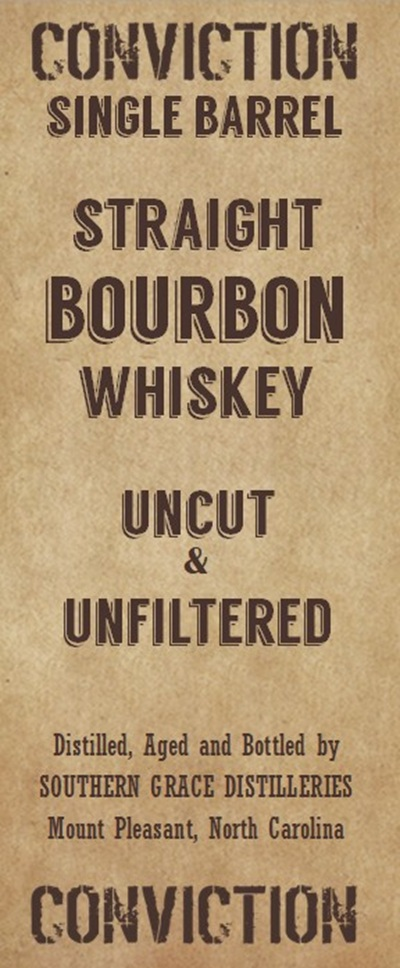
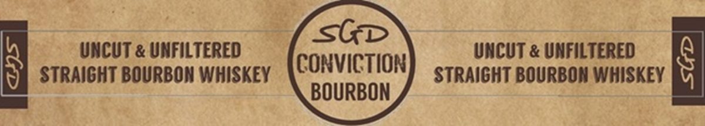

# TTB COLA Label Images - TTBID 26295001000278

**Brand Name:** CONVICTION

**Issue Date:** 10/26/2026

**Origin Code:** 35

**Product Class/Type:** 101

**Source:** [TTB Public COLA Registry](https://ttbonline.gov/colasonline/viewColaDetails.do?action=publicFormDisplay&ttbid=26295001000278)

## Label Images

### Back Label

### Front Label

### Label 3

### Label 4

## Extracted Label Text

*Text extracted via OCR - may contain errors*

### Back Label

CONVICTION
A STRO NGLY HELD BELIEF
Southern Grace Distilleries was founded on
the
belief that great whiskeys are born of
tireless effort and
relentless commitment
to quality
We believe Conviction Single
Barrel Straight Bourbon Whiskey serves to
prove that point:
sour mash whiskey in the old tradition;
Conviction Bourbon is craft distilled in
small batches and aged on site: Conviction
goes garing to glass at Southern Grace and
is always bottled; uncut; at cask strength
We are proud of Conviction Single Barrel
Bourbon-
We hope you will be equally proud
to drink it and serve it to your friends and
family _
Always
serve and drink responsibly_
WwwSouthernGraceDistilleries com
GOVERNMENT WARNING:
(1) According to the Surgeon
General, women should not
drink alcoholic beverages
8
during pregnancy because of
the risk of birth defects: (2)
Consumption of alcoholic
beverages impairs your abil-
8
ity to drive
car or operate
machinery, and may cause
health problems_

### Front Label

STRAICHT
BOURBON
WHISKEY
458
Barrel #
100.0
]
3
Sour Mash
Single Barrel
Cask Strength
750 ML

### Label 3

COMVICTION
SINGLE BARREL
STRAIGHT
BOURBON
WHISKEY
UnCUT
UNFILTERED
Distilled, Aged and  Bottled  by
SOUTHERN  GRACE DISTILLERIES
Mount Pleasant  North  Carolina
CONVICTION

### Label 4

sGpD

echt ourireme

UNCU

straisHT BouRBON WHiskey \CONVICTION) cre nicut BOURBON WHISKEY

BOURBON
