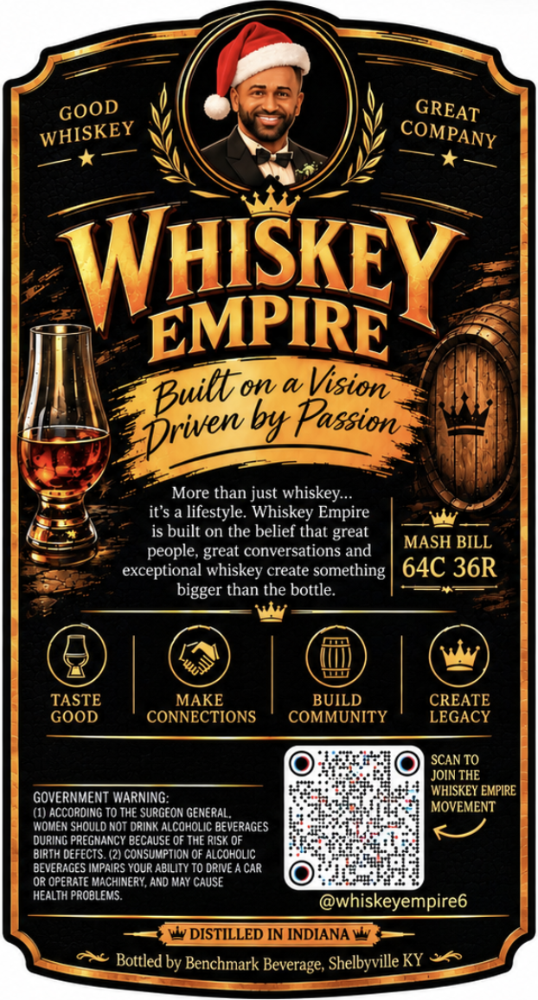
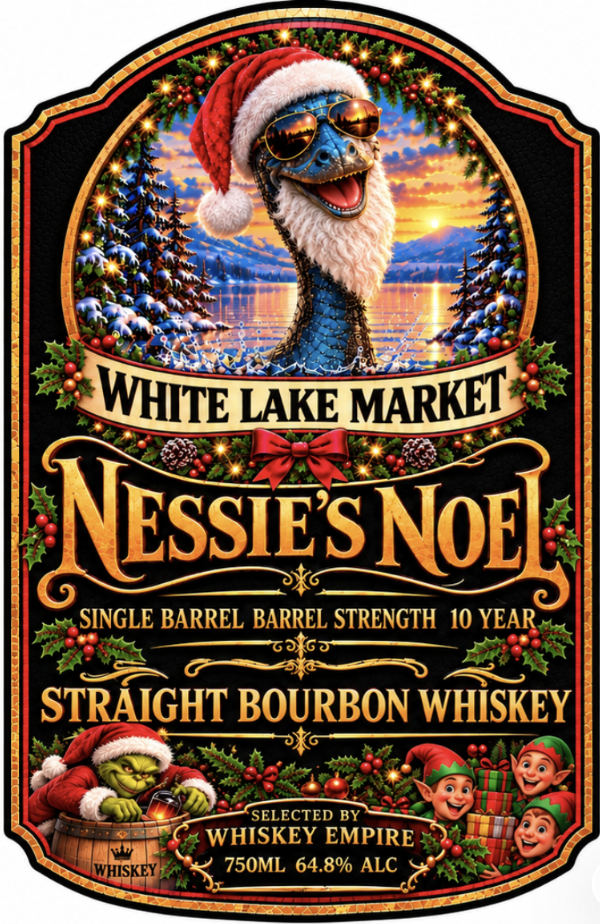

# TTB COLA Label Images - TTBID 26295001000286

**Brand Name:** NESSIE'S NOEL

**Issue Date:** 10/27/2026

**Origin Code:** 22

**Product Class/Type:** 101

**Source:** [TTB Public COLA Registry](https://ttbonline.gov/colasonline/viewColaDetails.do?action=publicFormDisplay&ttbid=26295001000286)

## Label Images

### Back Label

### Front Label

## Extracted Label Text

*Text extracted via OCR - may contain errors*

**Detected Proof:** 129.6
**Detected Age:** 10 Years

### Back Label

GOOD
WHSkEY
EMPIRE
W
Vision
byt Passion
More than just whiskey _
it'$ a lifestyle. Whiskey Empire
is built on the belief that great
MASH BILL
people, great conversations and
exceptional whiskey create something
64C 36R
bigger than the bottle:
TASTE
MAKE
BUILD
CREATE
GOOD
CONNECTIONS
COMMUNITY
LEGACY
SCAN TO
JOIN THE
GOVERNMENT WARNiNG
WHISKEY EMPIRE
(I) According T0 THE SURGEON GENERAL
MOVEMENT
WOwEN SHOULD NOT ORInk AlcOHOLIC BEVERAGES
DURING PREGHANCY BecaUSE OF THE RIsk OF
BIRTH DEFEctS: (2) consumption Of Alcoholic
DEVERAGES IMPAIRS YOUR ADILITY T0 DRIVE A CAR
Or Operate Machinery, ANd May CAUSE
HEALTH PROBLEMS:
whiskeyempire6
Ww DISTILLED IN INDIANA W
Bottled by Benchmark Beverage; Shelbyville KY
GREAT
COMPANY
WHISKEY
Drwet
on _

### Front Label

LAKE
NOE
SINGLE BARREL BARREL STRENGTH 10 YEAR
STRAIGHT BOURBON WHISKEY
SELECTED
WHISKEY EMPIRE
WHISKEY
750ML 64.8% ALC
MARKE
WHITE "
NESSIES
