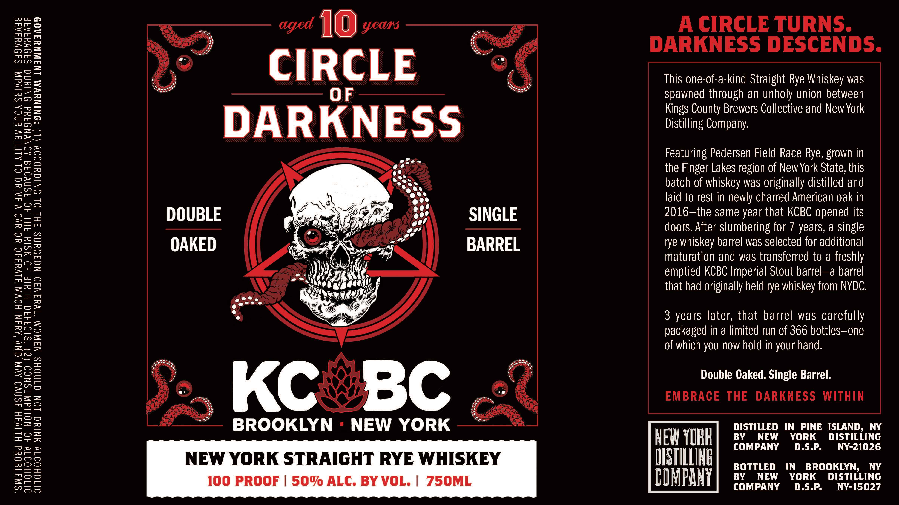

# TTB COLA Label Images - TTBID 26295001000308

**Brand Name:** CIRLCE OF DARKNESS RYE WHISKEY

**Issue Date:** 10/26/2026

**Origin Code:** 02

**Product Class/Type:** 102

**Source:** [TTB Public COLA Registry](https://ttbonline.gov/colasonline/viewColaDetails.do?action=publicFormDisplay&ttbid=26295001000308)

## Label Images

### Label 1

## Extracted Label Text

*Text extracted via OCR - may contain errors*

**Detected Age:** 7 Years

### Label 1

“SIWI19OUd HITVIH JSNVO AVN CNV ‘AMINIHOVW JLVuadO0 YO YVO VIAING OL ALITISV UNOA SUIVdWI SIDVYIAIS
JITOHOITY 40 NOILdWASNOD (2) “S194d4d0 HLald 40 WSIY FHL 40 ASMVOAG AONWNOFYd INIYNG SAIVYIAIG
JITOHOITY MNING LON GINOHS NAWOM ‘1¥4IN39 NOFDUNS FHL OL ONIGHOIIV (T) “ONINUWM LNIWNYIAOD

CIRCLE
DARKNESS

SINGLE

DOUBLE
BARREL

OAKED

BROOKLYN - NEW YORK
NEW YORK STRAIGHT RYE WHISKEY

A CIRCLE TURNS.

DARKNESS DESCENDS.

This one-of-a-kind Straight Rye Whiskey was
Spawned through an unholy union between
Kings County Brewers Collective and New York
Distilling Company.

Featuring Pedersen Field Race Rye, grown in
the Finger Lakes region of New York State, this
batch of whiskey was originally distilled and
laid to rest in newly charred American oak in
2016-the same year that KCBC opened its
doors. After slumbering for 7 years, a single

rye whiskey barrel was selected for additional
maturation and was transferred to a freshly
emptied KCBC Imperial Stout barrel—a barrel
that had originally held rye whiskey from NYDC.

3 years later, that barrel was carefully
packaged in a limited run of 366 bottles—one
of which you now hold in your hand.

Double Oaked. Single Barrel.
EMBRACE THE DARKNESS WITHIN

DISTILLING BOTTLED IN BROOKLYN, NY

GOMPANT] ex caw, TORN, Digriune
