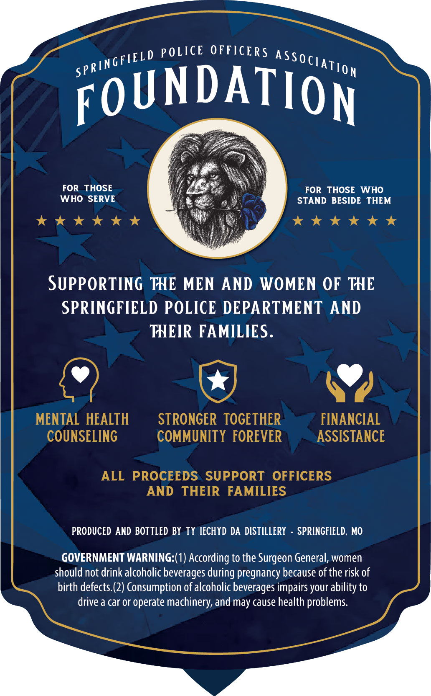
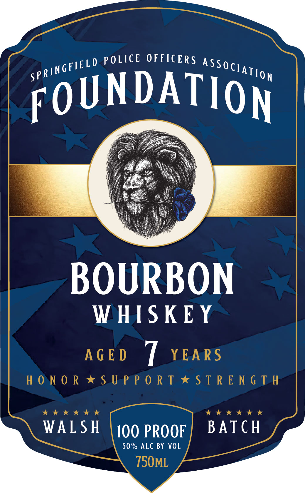

# TTB COLA Label Images - TTBID 26295001000316

**Brand Name:** SPRINGFIELD POLICE OFFICERS ASSOCIATION

**Fanciful Name:** FOUNDATION

**Issue Date:** 10/26/2026

**Origin Code:** 29

**Product Class/Type:** 141

**Source:** [TTB Public COLA Registry](https://ttbonline.gov/colasonline/viewColaDetails.do?action=publicFormDisplay&ttbid=26295001000316)

## Label Images

### Back Label

### Front Label

## Extracted Label Text

*Text extracted via OCR - may contain errors*

**Detected Proof:** 100

### Back Label

spRIN

grleLD POLICE OFFICERS ASSo¢) ir

Tloy

OUNDATIO

FO

ON

gen

FOR THOSE

FOR THOSE WHO

WHO SERVE

STAND BESIDE THEM

kkk KK

kkk KKK

SUPPORTING THE MEN AND WOMEN OF THE

SPRINGFIELD POLICE DEPARTMENT AND

THEIR FAMILIES

V7

)

MENTAL HEALTH

STRONGER TOGETHER

FINANCIAL

COUNSELING

COMMUNITY FOREVER

ASSISTANCE

ALL PROCEEDS SUPPORT OFFICERS

AND THEIR FAMILIES

PRODUCED AND BOTTLED BY TY IECHYD DA DISTILLERY - SPRINGFIELD, MO

GOVERNMENT WARNING:(1) According to the Surgeon General, women

should not drink alcoholic beverages during pregnancy because of the risk of

birth defects.(2) Consumption of alcoholic beverages impairs your ability to

drive a car or operate machinery, and may cause health problems

### Front Label

ELD POLICE OFFICERS 10

FOUNDATION |

BOURBON

WHISKEY
7

WALSH 100 PROOF BATCH

50% ALC BY VOL
