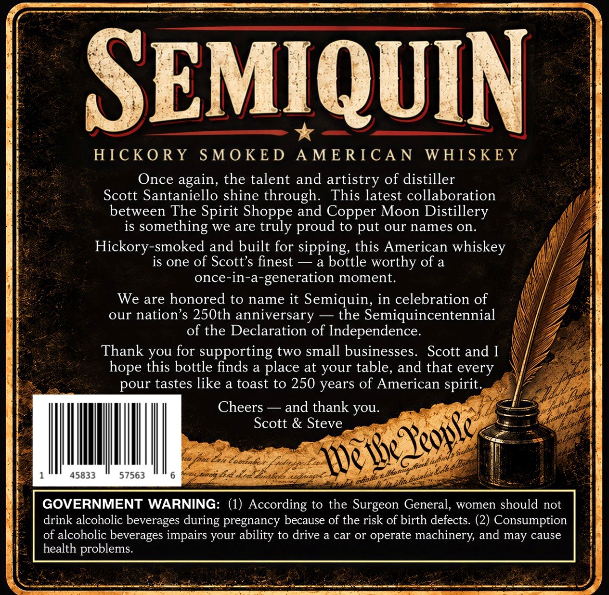
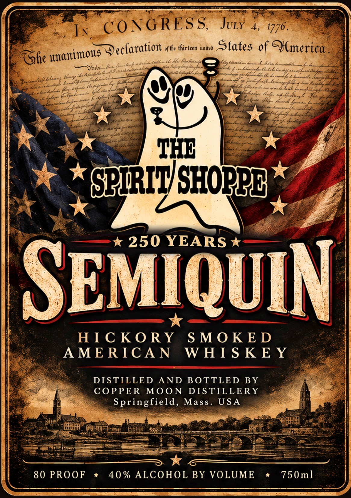

# TTB COLA Label Images - TTBID 26295001000319

**Brand Name:** THE SPIRIT SHOPPE

**Fanciful Name:** HICKORY SMOKED AMERICAN WHISKEY

**Issue Date:** 10/27/2026

**Origin Code:** 26

**Product Class/Type:** 140

**Source:** [TTB Public COLA Registry](https://ttbonline.gov/colasonline/viewColaDetails.do?action=publicFormDisplay&ttbid=26295001000319)

## Label Images

### Back Label

### Front Label

## Extracted Label Text

*Text extracted via OCR - may contain errors*

**Detected Proof:** 80

### Back Label

SEMIQUIN
HICKO RY
SMOKE D
A ME RIC A N
WHS KEY
Once again, the talent and artistry of distiller
Scott Santaniello shine through:
This latest collaboration
between The Spirit
and Copper Moon Distillery
is
something
are truly
to put our names on:
Hickory-smoked and built for sipping, this American whiskey
is one of Scott's finest
bottle worthy of a
once-in-a-generation moment_
We are honored to name it Semiquin, in celebration of
our nation's 250th anniversary
the Semiquincentennial
of the Declaration of Independence.
Thank you for supporting two small businesses.
Scott and [
hope this bottle finds a place at your table, and that every
pour tastes like a toast to 250
of American
Je
Cheers
and thank you_
Scott & Steve
Tactnle
6tt=
45833
57563
esu0d Baa
GOVERNMENT WARNING: (1) According to the Surgeon General;
women should not
drink alcoholic beverages
pregnancy because of the risk of birth defects: (2) Consumption
of alcoholic beverages impairs your ability to drive a car or operate machinery; and may cause
health problems_
Shoppe
proud
we
spirit.
years
Zeople
IDe bea
ilb
Iledidi
during

### Front Label

I ee ee —
} Ss, She. ss ~ t of he thirteen unit S on 1 01
Fhe unanimous S eclaration 46 irre nto States of Mmner ica.
os: Ne aaah “ ew a CA Lash th intial
zy aaty ba Spee ¥ por ies a GP GH: 5 Sprain Gas hn same ft bens fea j
Max "9 Z Gear NJ \/ ke gi Le |
ek xe
t Se kG KF -|
Feeh h / : ea |
| PS * 250 YEARS x |
\ *
i HICKORY SMOKED i
| AMERICAN WHISKEY |
| Seti DISTILLED AND BOTTLED BY ES ge )
| a begs COPPER MOON DISTILLERY 4g eee |
i| a ‘ee » Springfield, Mass. USA {93k pre
H 7 oh ie eee Se eae
ee
| 80 PROOF * 40% ALCOHOL BY VOLUME * 750ml |
