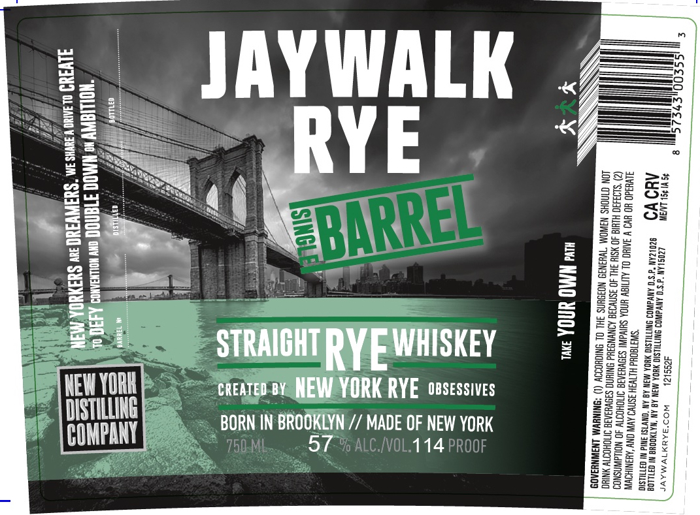

# TTB COLA Label Images - TTBID 26295001000415

**Brand Name:** JAYWALK RYE SINGLE BARREL

**Issue Date:** 10/26/2026

**Origin Code:** 02

**Product Class/Type:** 102

**Source:** [TTB Public COLA Registry](https://ttbonline.gov/colasonline/viewColaDetails.do?action=publicFormDisplay&ttbid=26295001000415)

## Label Images

### Label 1

## Extracted Label Text

*Text extracted via OCR - may contain errors*

**Detected Proof:** 114

### Label 1

JAYWALK
1
1
3
RYE
3
E2
J#
9
1
0
1
1
##
h
0
Ii
0
4
5
STRAICHT
WHISKEY
2
2
0
RYEL
4
!
I
2
h
NEWYORH
CREATED ey NEW YORK RYE  OBSESSIVES
8
DISTILLING
BORN IN BROOKLYN
MADE OF NEW YORK
MH
58
COMPANY
750 ML;
57 % ALC NOL ~
14 PROOF
1
1
1
M
1
BBERRREL
