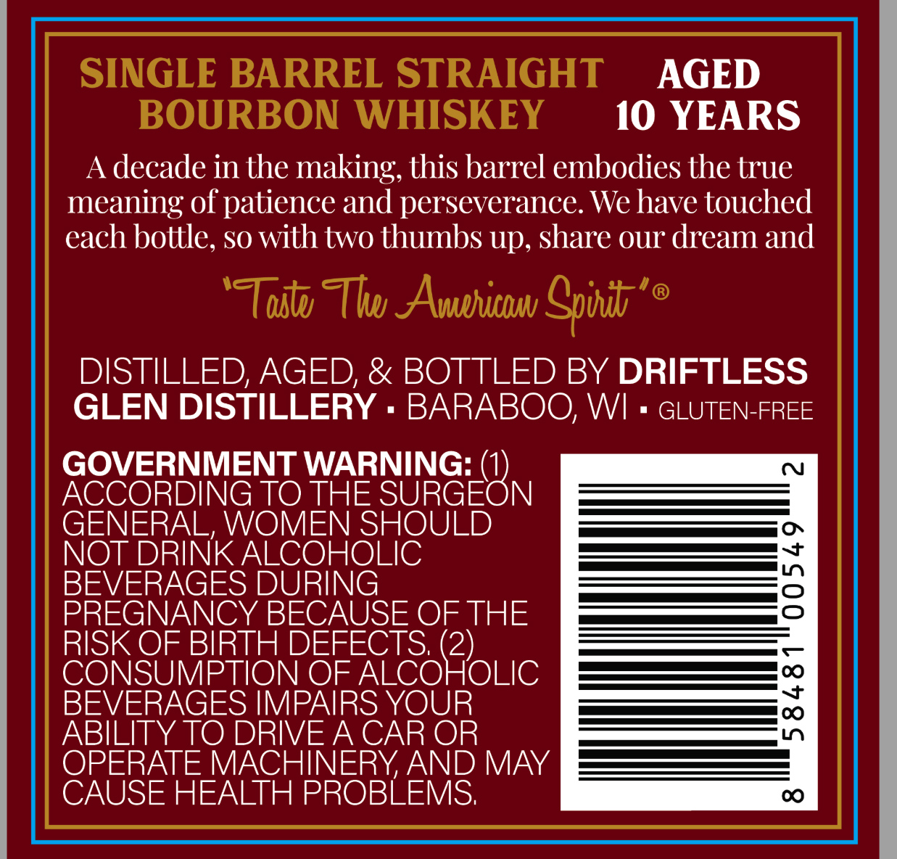
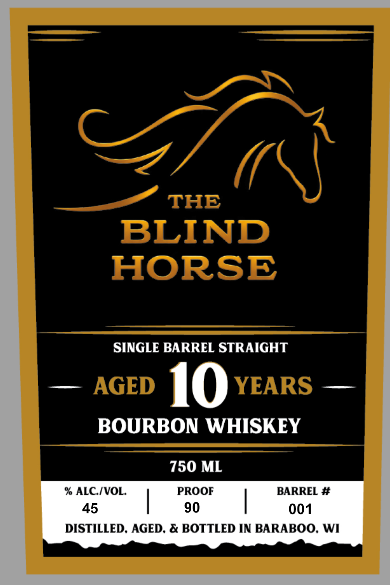

# TTB COLA Label Images - TTBID 26295001000424

**Brand Name:** THE BLIND HORSE

**Issue Date:** 10/26/2026

**Origin Code:** 48

**Product Class/Type:** 101

**Source:** [TTB Public COLA Registry](https://ttbonline.gov/colasonline/viewColaDetails.do?action=publicFormDisplay&ttbid=26295001000424)

## Label Images

### Back Label

### Front Label

## Extracted Label Text

*Text extracted via OCR - may contain errors*

**Detected Age:** 10 Years

### Back Label

SINGLE BARREL STRAIGHT
AGED
BOURBON WHISKEY
10 YEARS
A
decade in the making; this barrel embodies the true
meaning of patience and perseverance. Wehave touched
each bottle, so with two thumbs up, share our dream and
'TTostu Thwu AAvehuicbu Spod'
DISTILLED, AGED; & BOTTLED BY DRIFTLESS
GLEN DISTILLERY
BARABOO, WI
GLUTEN-FREE
GOVERNMENT WARNING:
ACCORDING TO THE SURGEON
GENERAL, WOMEN SHOULD
NOT DRINKALCOHOLIC
BEVERAGES DURING
2
PREGNANCY BECAUSE OF THE
RISK OF BIRTH DEFECTS (2)
CONSUMPTION OF ALCOHOLIC
BEVERAGES IMPAIRS YOUR
1
ABILITY TO DRIVEA CAR OR
OPERATE MACHINERYAND MAY
CAUSE HEALTH PROBLEMS;

### Front Label

THE
BLIND
HORSE
SINGLE BARREL STRAIGHT
AGED
10
YEARS
BOURBON WHISKEY
750 ML
% ALCIVOL.
PROOF
BARREL #
45
90
001
DISTILLED. AGED. & BOTTLED IN BARABOO. WI
