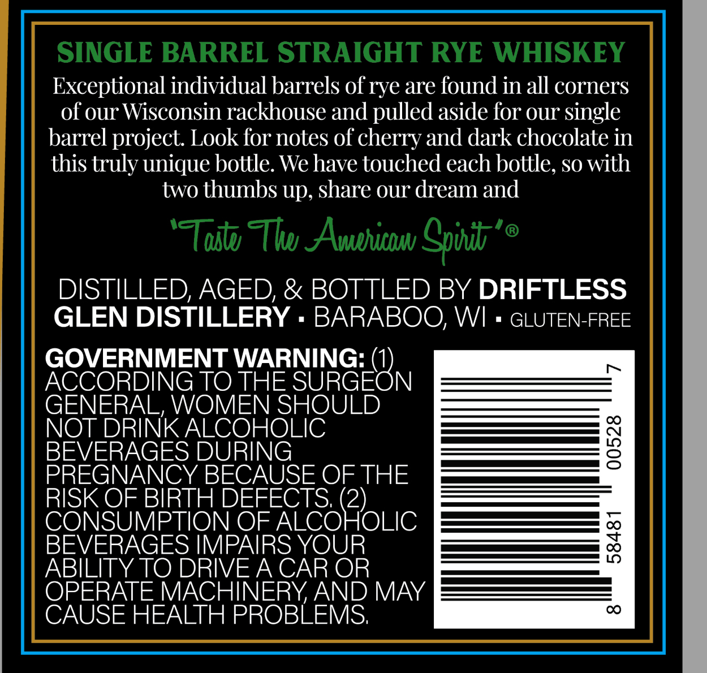
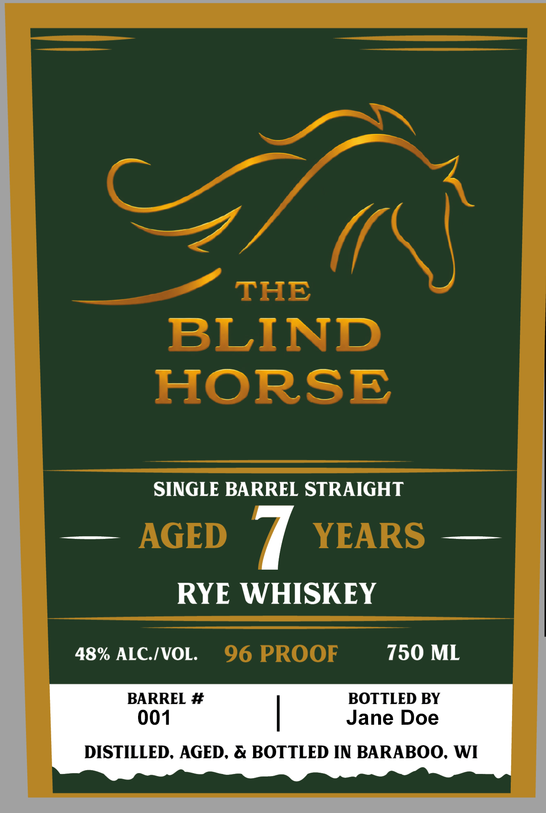

# TTB COLA Label Images - TTBID 26295001000428

**Brand Name:** THE BLIND HORSE

**Issue Date:** 10/27/2026

**Origin Code:** 48

**Product Class/Type:** 102

**Source:** [TTB Public COLA Registry](https://ttbonline.gov/colasonline/viewColaDetails.do?action=publicFormDisplay&ttbid=26295001000428)

## Label Images

### Back Label

### Front Label

## Extracted Label Text

*Text extracted via OCR - may contain errors*

**Detected Proof:** 96

### Back Label

SINGLE BARREL STRAIGHT RYE WHISKEY
Exceptional individual barrels of rye are found in all corners
of our Wisconsin rackhouse and pulled aside for our single
barrel project  Look for notes of cherry and dark chocolate in
this truly unique bottle. We have touched each bottle, so with
two thumbs up, share our dream and
'TToitu Thu AAvphicnuv Spoudb''
DISTILLED, AGED; & BOTTLED BY DRIFTLESS
GLEN DISTILLERY
BARABOO; WI
GLUTEN-FREE
GOVERNMENT WARNING:
ACCORDING TO THE SURGEON
GENERAL, WOMEN SHOULD
NOT DRINK ALCOHOLIC
BEVERAGES DURING
3
PREGNANCY BECAUSE OF THE
RISK OF BIRTH DEFECTS (2)
CONSUMPTION OF ALCOHOLIC
BEVERAGES IMPAIRS YOUR
3
ABILITY TO DRIVEA CAR OR
OPERATE MACHINERYAND MAY
CAUSE HEALTH PROBLEMS;

### Front Label

THE
BLIND
HORSE
SINGLE BARREL STRAIGHT
AGED
YEARS
RYE WHISKEY
48% ALCIVOL.
96 PROOF
750 ML
BARREL #
BOTTLED BY
001
Jane Doe
DISTILLED, AGED, & BOTTLED IN BARABOO, WI
