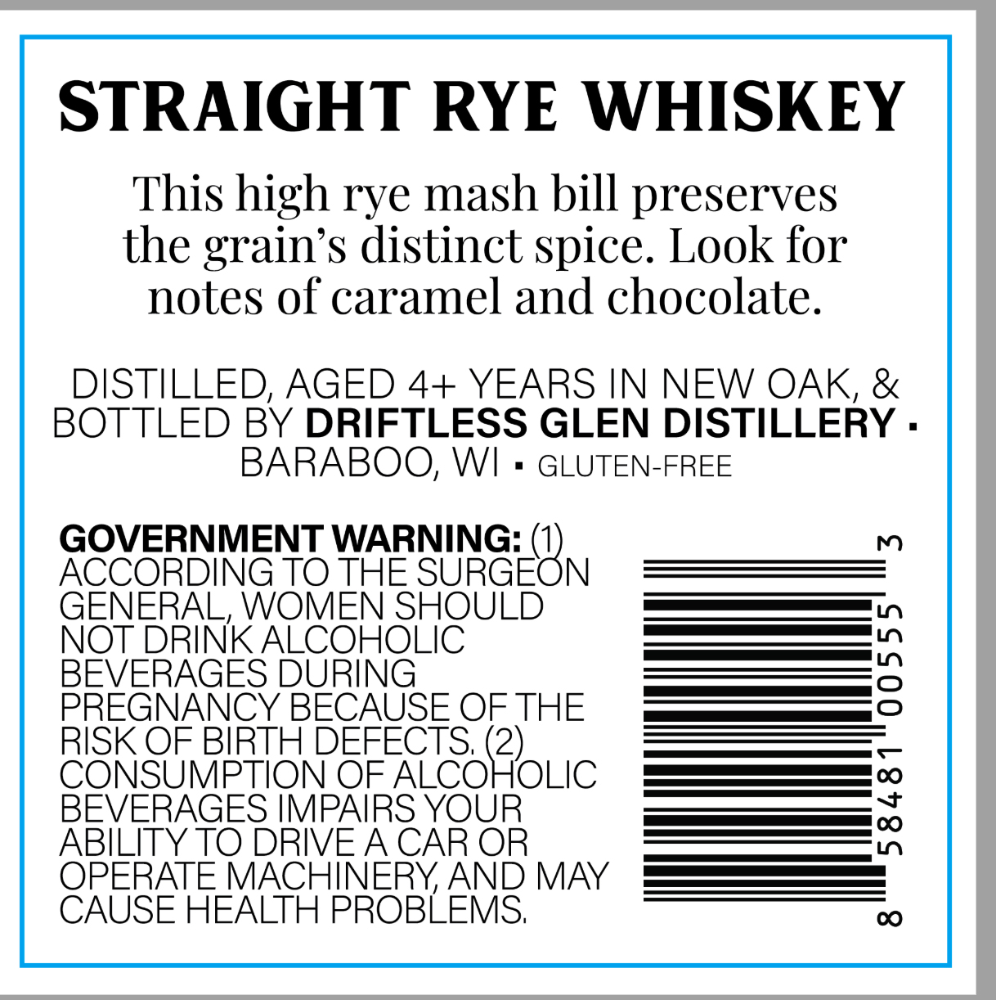
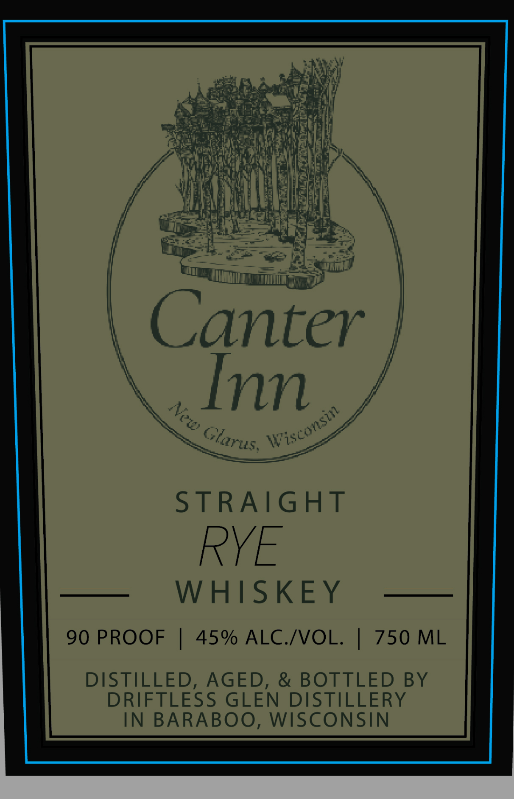

# TTB COLA Label Images - TTBID 26295001000467

**Brand Name:** CANTER INN

**Issue Date:** 10/26/2026

**Origin Code:** 48

**Product Class/Type:** 102

**Source:** [TTB Public COLA Registry](https://ttbonline.gov/colasonline/viewColaDetails.do?action=publicFormDisplay&ttbid=26295001000467)

## Label Images

### Back Label

### Front Label

## Extracted Label Text

*Text extracted via OCR - may contain errors*

**Detected Proof:** 90

### Back Label

STRAIGHT RYE WHISKEY
This high rye mash bill preserves
the grain's distinct spice. Look for
notes of caramel and chocolate.
DISTILLED, AGED 4+ YEARS IN NEW OAK, &
BOTTLED BY DRIFTLESS GLEN DISTILLERY .
BARABOO; WI
GLUTEN-FREE
GOVERNMENT WARNING: (1)
m
ACCORDING TO THE SURGEON
GENERAL, WOMEN SHOULD
NOT DRINK ALCOHOLIC
BEVERAGES DURING
2
PREGNANCY BECAUSE OFTHE
RISK OF BIRTH DEFECTS;
CONSUMPTION OF
Seoouic
BEVERAGES IMPAIRS YOUR
[
ABILITY TO DRIVEA CAR OR
OPERATE MACHINERYAND MAY
CAUSE HEALTH PROBLEMS;
C

### Front Label

Canter
Inn
STRAIGHT
RYE
WHISKEY
90 PROOF
45% ALC.IVOL:
750 ML
DISTILLED, AGED, & BOTTLED BY
DRIFTLESS GLEN DISTILLERY
IN
BARABOO,
WISCONSIN
a
Wisconsin
Glarus.
