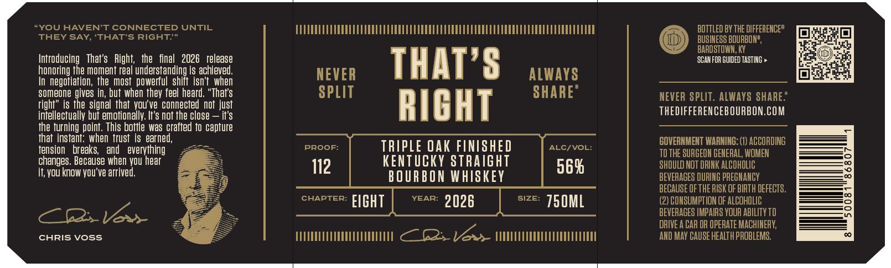
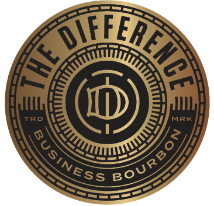

# TTB COLA Label Images - TTBID 26295001000486

**Brand Name:** THE DIFFERENCE BUSINESS BOURBON

**Issue Date:** 10/26/2026

**Origin Code:** 22

**Product Class/Type:** 101

**Source:** [TTB Public COLA Registry](https://ttbonline.gov/colasonline/viewColaDetails.do?action=publicFormDisplay&ttbid=26295001000486)

## Label Images

### Label 1

### Label 2

### Label 3

## Extracted Label Text

*Text extracted via OCR - may contain errors*

*2 image(s) excluded: text did not meet readability threshold*

**Detected Proof:** 112

### Label 1

YOU HAVEN’T CONNECTED UNTIL

UUVUVEOTAUTEOTU CTA ODROU UC TOCA UT OPEOUOUTOTE OTA TDROU ET TOCE TUE TOUO TEETH

BOTTLED BY THE DIFFERENGE®

THEY SAY, ‘THAT’S RIGHT.”

BUSINESS BOURBON®,

Eel

@

BARDSTOWN, KY

Ay

Introducing That's Right, the final 2026 release

‘SCAN FOR GUIDED TASTING »

honoring the moment real understanding is achieved.

NEVER

THAT’S ALWAYS

jopa es

In negotiation, the most powerful shift isn't when

someone gives in, but when they feel heard. “That's

SPLIT

SHARE®

NEVER SPLIT. ALWAYS SHARE:

right” is the signal that you've connected not just

intellectually but emotionally. I's not the close — it's

RIGHT

THEDIFFERENCEBOURBON.COM

the turning point. This bottle was crafted to capture

that instant: when trust is earned,

GOVERNMENT WARNING: (1) ACCORDING

tension breaks, and everything

_—

PROOF:

TRIPLE OAK FINISHED

ALC/VOL:

changes. Because when you hear

KENTUCKY STRAIGHT

SHOULD NOT DRINK ALCOHOLIC

TO THE SURGEON GENERAL, WOMEN

it, you know you've arrived,

oe

12

56%

BOURBON WHISKEY

BEVERAGES DURING PREGNANCY

BECAUSE OF THE RISK OF BIRTH DEFECTS.

caper: FIGHT

(2) CONSUMPTION OF ALCOHOLIC

BEVERAGES IMPAIRS YOUR ABILITY TO

DAIVE A CAR OF OPERATE MACHINERY,

CHRIS VOSS.

S

UUTTTTTTT TEETH TTT CO ar TUTTE TT TTATTTTETE TTT

AND MAY CAUSE HEALTH PROBLEMS,
