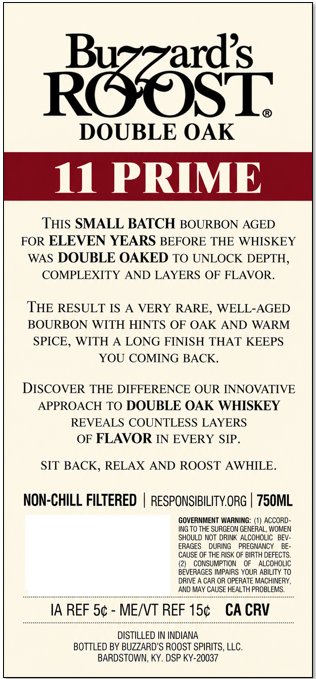
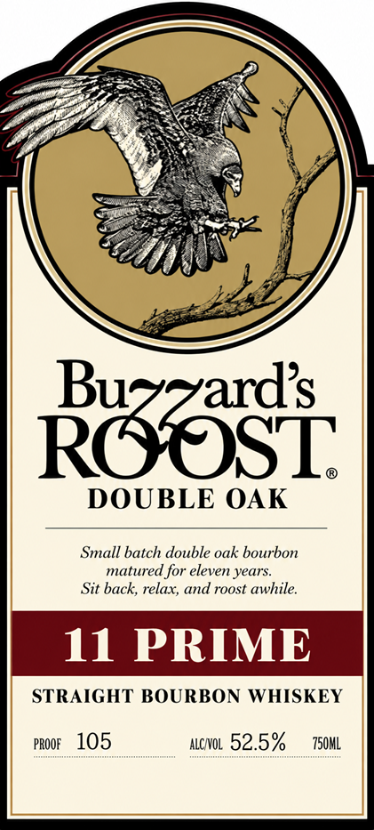

# TTB COLA Label Images - TTBID 26295001000498

**Brand Name:** BUZZARD'S ROOST

**Issue Date:** 10/26/2026

**Origin Code:** 22

**Product Class/Type:** 101

**Source:** [TTB Public COLA Registry](https://ttbonline.gov/colasonline/viewColaDetails.do?action=publicFormDisplay&ttbid=26295001000498)

## Label Images

### Back Label

### Label 1

## Extracted Label Text

*Text extracted via OCR - may contain errors*

**Detected Proof:** 105

### Back Label

Raasi
DOUBLE OAK
I1 PRIME
Tus SMALL BATCH BOURBON AGED
FOR ELEVEN YEARS BEFORE THE WHISKEY
WAS DOUBLE OAKED TO UNLOCK DEPTH,
COMPLEXITY
AND LAYERS OF FLAVOR.
THE RESULT [S
VERY RARE, WELL-AGED
BOURBON WITH HINTS OF OAK AND WARM
SPICE, WITH
LONG FINISH THAT KEEPS
YOU COMING BACK.
DISCOVER THE DIFFERENCE QUR INNOVATIVE
APPROACH T0 DOUBLE OAK WHISKEY
REVEALS COUNTLESS LAYERS
OF FLAVOR IN EVERY SIP.
SIT BACK, RELAX AND ROOST AWHILE.
NON-CHILL FILTERED
RESPONSIBILITY ORG | 750ML
GCMEAMNEMT NaAMNS
Looord
Lnoin sataimaeaalan
S4ouo Wor Oant 4colouc HEa
[RIGS
DuRNG
PA[GUSI
c4S nF TFF
OEIRTAO-FECTS
-
Al
BMVERAGES
Jqua ABLMN T0
naneicao3orrATFKLcHCFR
Gucci
Pacdidus
IA REF 5c
MEIVT REF 15c
CA CRV
DISTILLEO IN INDIAN4
BOTTLED BY BUZZARD"'S ROOST SPIRITS, LLC
BARDSTOWIN KY, DSP KY-20037

### Label 1

Buzzards
ROOST
DOUBLE OAK
Small batch double oak bourbon
matured for eleven years:
Sit back; relax; and roost awhile:
11 PRIME
STRAIGHT BOURBON WHISKEY
PROOF
105
ALCNOL 52.5%
750ML
