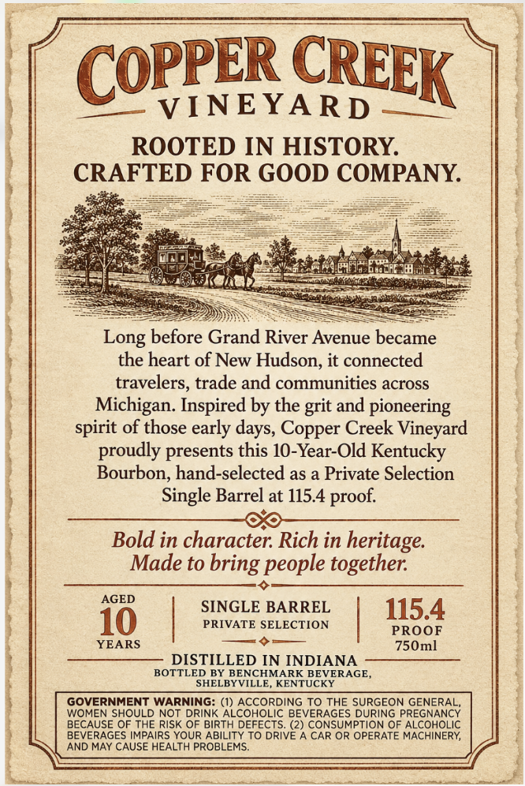
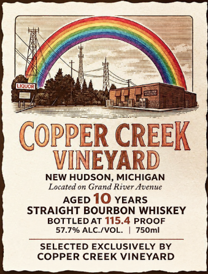

# TTB COLA Label Images - TTBID 26295001000538

**Brand Name:** COPPER CREEK VINEYARD

**Issue Date:** 10/28/2026

**Origin Code:** 22

**Product Class/Type:** 101

**Source:** [TTB Public COLA Registry](https://ttbonline.gov/colasonline/viewColaDetails.do?action=publicFormDisplay&ttbid=26295001000538)

## Label Images

### Back Label

### Label 1

## Extracted Label Text

*Text extracted via OCR - may contain errors*

**Detected Proof:** 115.4
**Detected Age:** 10 Years

### Back Label

COPPER
VINEYARD
ROOTED IN HISTORY
CRAFTED FOR GOOD COMPANY
Long before Grand River Avenue became
the heart of
Hudson, it connected
travelers, trade and communities across
Inspired by the grit and pioneering
spirit of those early
Copper Creek Vineyard
proudly presents this 10-Year-Old Kentucky
Bourbon, hand-selected as a Private Selection
Single Barrel at 115.4
Bold in character: Rich in
heritage
Made to
people together:
AGED
SINGLE BARREL
115.4
10
PRIVATE SELECTION
PROOF
YEARS
750ml
DISTILLED IN INDIANA
BOTTLED BY BENCHMARK BEVERAGE
SHELBYVILLE
KENTUCKY
GOVERNMENT WARNING: (1) ACCORDING TO THE SURGEON GENERAL,
WOMEN SHOULD NOT DRINK ALCOHOLIC BEVERAGES DURING PREGNANCY
BECAUSE OF THE RISK OF BIRTH DEFECTS. (2) CONSUMPTION OF ALCOHOLIC
BEVERAGES IMPAIRS YOUR ABILITY TO DRIVE A CAR OR OPERATE MACHINERY
AND MAY CAUSE HEALTH PROBLEMS_
CREEK
New
Michigan
days,
proof:
bring

### Label 1

Lidlop
COPPER CREEK
VINEYARD
NEW HUDSON, MICHIGAN
Located on Grand River Avenue
AGED 10 YEARS
STRAIGHT BOURBON WHISKEY
BOTTLED AT 115.4 PROOF
57.796 ALC /VOL_
750ml
SELECTED EXCLUSIVELY BY
COPPER CREEK VINEYARD
