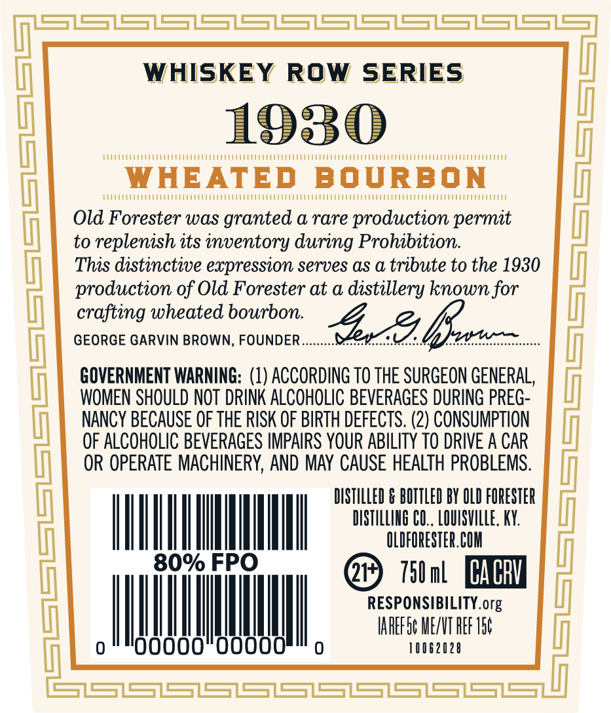
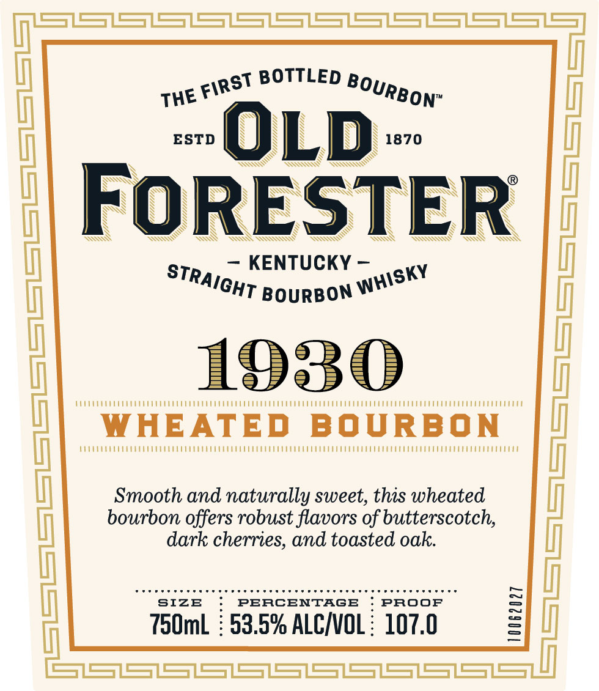
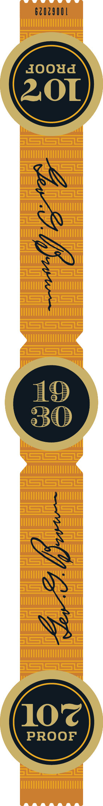

# TTB COLA Label Images - TTBID 26295001000548

**Brand Name:** OLD FORESTER

**Fanciful Name:** 1930 WHEATED BOURBON

**Issue Date:** 11/05/2026

**Origin Code:** 22

**Product Class/Type:** 101

**Source:** [TTB Public COLA Registry](https://ttbonline.gov/colasonline/viewColaDetails.do?action=publicFormDisplay&ttbid=26295001000548)

## Label Images

### Back Label

### Front Label

### Label 3

## Extracted Label Text

*Text extracted via OCR - may contain errors*

*1 image(s) excluded: text did not meet readability threshold*

**Detected Proof:** 107

### Back Label

S1S1S37S31S31S37S37S37S1S37SS2
WHISKEY
ROW
SERIES
1930
WHEATED
BOURBON
Old Forester waS granted a rare production permit
to replenish its inventory during Prohibition:
This distinctive expression serves aS a tribute to the 1930
(
production of Old Forester at a distillery known for
crafting wheated bourbon
GEORGE GARVIN BROWN, FOUNDER
bszz=
GOVERNMENT WARNING: (1) ACCORDING TO THE SURGEON GENERAL,
WOMEN SHOULD NOT DRINK ALCOHOLIC BEVERAGES DURING PREG-
NANCY BECAUSE OF THE RISK OF BIRTH DEFECTS . (2) CONSUMPTION
OF ALCOHOLIC BEVERAGES IMPAIRS YOUR ABILITY TO DRIVE A CAR
OR OPERATE MACHINERY, AND MAY CAUSE HEALTH PROBLEMS.
DISTILLED & BOTTLED BY OLD FORESTER
DISTILLIHG CU., LOUISVILLE, KY:
OLDFORESTER.COM
80% FPO
750mL
CA CBV
RESPONSIBILITY.org
IAREF Sc MEZNT REF I56
Uu
10062028
S1SSSS1SSS1S

### Front Label

SZSZSZS=ZS=ZS7S=ZSSZS=7S=7S=Z
BOTTLED
ESTD
OLD
1870
FoRESTER
KENTUCKY
A
1930
BOURBON
(
WHEATED
BOURBON
Smooth and naturally sweet, this wheated
bourbon offers robust flavors of butterscotch;
dark cherries; and toasted oak:
SIZE
PERCENTAGB
PROOF
750ml
53.5% ALCINOL :
107.0
IX
FIRST
BOURBON"
THE
STRAIGHT
WHISKY
