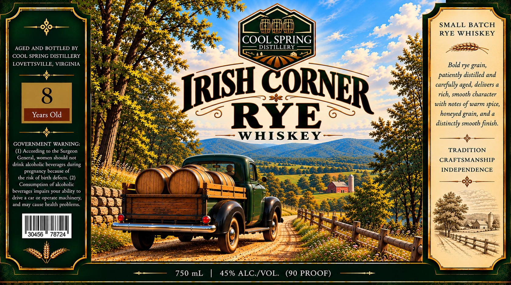

# TTB COLA Label Images - TTBID 26295001000556

**Brand Name:** COOL SPRING DISTILLERY

**Fanciful Name:** IRISH CORNER RYE WHISKEY

**Issue Date:** 10/28/2026

**Origin Code:** 05

**Product Class/Type:** 142

**Source:** [TTB Public COLA Registry](https://ttbonline.gov/colasonline/viewColaDetails.do?action=publicFormDisplay&ttbid=26295001000556)

## Label Images

### Label 1

## Extracted Label Text

*Text extracted via OCR - may contain errors*

**Detected Proof:** 90

### Label 1

SMALL BATCH
RYE WHISKEY
COOL SPRING
AGED AND BOTTLED BY
DISTILLERY
COOL SPRING DISTILLERY
LOVETTSVILLE, VIRGINIA
Bold rye
patiently distilled and
carefully
delivers a
rich,
character
with notes of warm spice,
Years Old
RYE
6 -
honeyed grain, and
distinctly smooth finish.
WHISKEY
GOVERNMENT WARNING:
(1) According to the
TRADITION
General ,
women
should not
CRAFTSMANSHIP
drink alcoholic beverages
pregnancy because of
INDEPENDENCE
the risk of birth defects: (2)
Consumption of alcoholic
beverages impairs your ability to
drive
car or operate
machinery;
and may cause health
problems
30456
78724
750 mL
45% ALC /VOL.
(90 PROOF)
grain,
TRISH
CORNER
aged,
smooth
Surgeon
during
