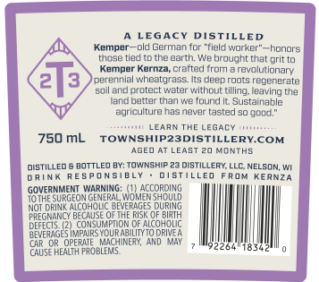
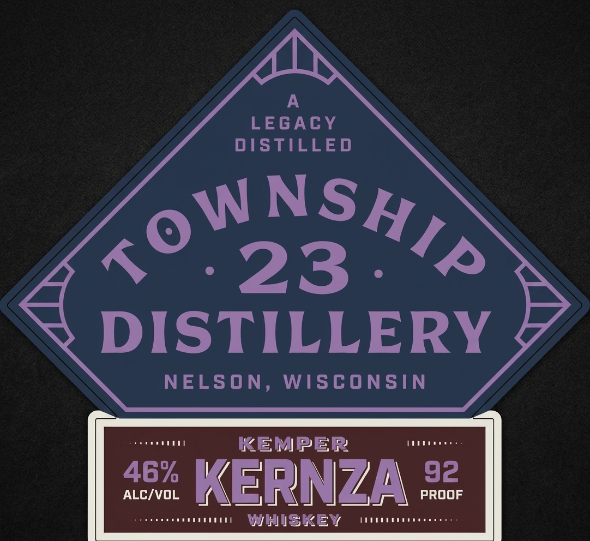

# TTB COLA Label Images - TTBID 26295001000599

**Brand Name:** KEMPER KERNZA WHISKEY

**Issue Date:** 10/30/2026

**Origin Code:** 48

**Product Class/Type:** 140

**Source:** [TTB Public COLA Registry](https://ttbonline.gov/colasonline/viewColaDetails.do?action=publicFormDisplay&ttbid=26295001000599)

## Label Images

### Back Label

### Front Label

### Label 3

## Extracted Label Text

*Text extracted via OCR - may contain errors*

*1 image(s) excluded: text did not meet readability threshold*

**Detected Proof:** 92

### Back Label

LEGAcY DISTIL
ED
Kemper-
pld German tr
"ield worker"
Nmnorc
KuuGe tlod
the earth; We broughtthal grit to
Kemper
Kernza
crafted
revdilinnay
2
perenniz
whcatgrass
Its deeproots regenerate
soil andprotect water
tilling; leaving tha
Iand better tnan we fourd it Sustainable
agriculturg hasnevar (asted
goud;'
LeARN THC
EGACY
750 mL
TOWNSHIPZ3DISTILLERKCOM
AGED AT LEAST 20 Months
MISTLLED
AOTTLed BY; TowNship 23 distILLERY;
MELSON
inK RESPON
ULLED
F RmV
KERNZA
GOVERNMENT Warning;
AccoRDiNG
SURCEON GENERAL Women shquld
NOT DRIN< ALCQHOLIC
BEVERAGES DURING
FREGNANCY BECAUSE OFTHE RISK QF BIRTH
dcFECTS
CONSUMPTON OF AicOHOLC
D5enGE
MMPAIRS YOUR ABILITYTQ DRINEA
CAR'OR   OPERATE  MACHIneRY, AND MAY
CAUSE HEALTH FROBLEMS
rum
ithout
LLC;

### Front Label

A
LEGACY
DISTILLED
23
DISTILLERY
NELSON ,
WISCONSIN
KEMPER
46%
KErNZA
92
ALCIVOL
PROOF
WHISKEY
NSHIP
Tow
