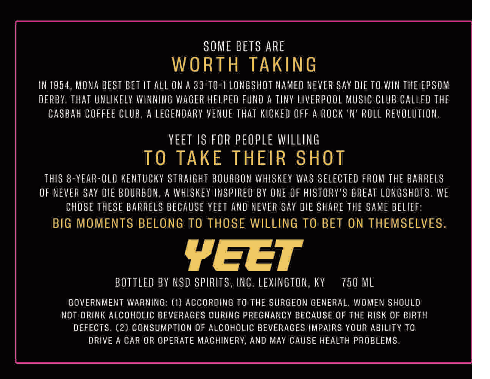
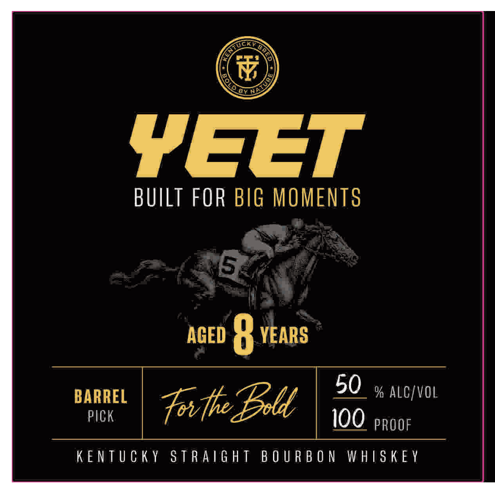

# TTB COLA Label Images - TTBID 26295001000698

**Brand Name:** YEET

**Issue Date:** 10/27/2026

**Origin Code:** 22

**Product Class/Type:** 101

**Source:** [TTB Public COLA Registry](https://ttbonline.gov/colasonline/viewColaDetails.do?action=publicFormDisplay&ttbid=26295001000698)

## Label Images

### Back Label

### Front Label

## Extracted Label Text

*Text extracted via OCR - may contain errors*

**Detected Proof:** 100
**Detected Age:** 9 Years

### Back Label

SOME BETS ARE
WORTH TAKING
IN 1954, MONA BEST BET IT ALL ON A 33- TO-1LONGSHOT NAMED NEVER SAY DLE TO WIN THE EPSOm
DERRY. ThAT UNLIKELV WINNING WAGiF HELPED FUnd A TinY LIVERPOOL MuSIC CLUB CAlled THE
Casbah COFFFE CLUB, A LEGENDARY VENUE That KICKEd OFF A Rock 'N' RolL REVOLUTIOM.
yeET IS FOR PEOPLE WILLING
TO TAKE THEIR SHOT
THIS 8-YEAR OLD KENTUCKV StRAIGHT BOURBOn WHISKEv Was SELECTED FROM THE BARRELS
OF NEVER Say DIE BOURBON,
4 WHISKEY INSPIREO BY ONE OF HISTORY'S GREAT LONGSHOTS . WE
CHOSE THESE BARRELS BECAUSE YEET AND NEVEA Say DIE SHARE THE SAME BELIEF:
BIG MOMENTS BELONG TO THOSE WILLING TO BET ON THEMSELVES.
YEEt
BOTTLed BY NSD SPIRITS , ING. LEXINGTON, KY
750 ML
COVERNMENT WARNING: (1) ACCORDING TO THE SURGEON GENERAL, WOMEN SHOULD
NOt DRiNK ALCOHOLIC BEVERAGES DURING PREGNANCY BECAUSE OF THE RISK 0F BIRTH
DEFECTS. (2) Consumption Of Alcoholic BEVERAGES IMPAIRS YOUR ABILITY TO
DRIVE A CAR UR OPERATE MACHINERY, AND May CAUSE HEALTH PROBLEMS:

### Front Label

VEET

BUILT FOR BIG MOMENTS

AGED 9 YEARS

50 » ALC/VOL

BARREL

PICK

Fritle Ble |

100 PROOF

KENTUCKY STRAIGHT BOURBON WHISKEY
