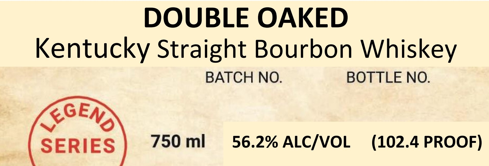
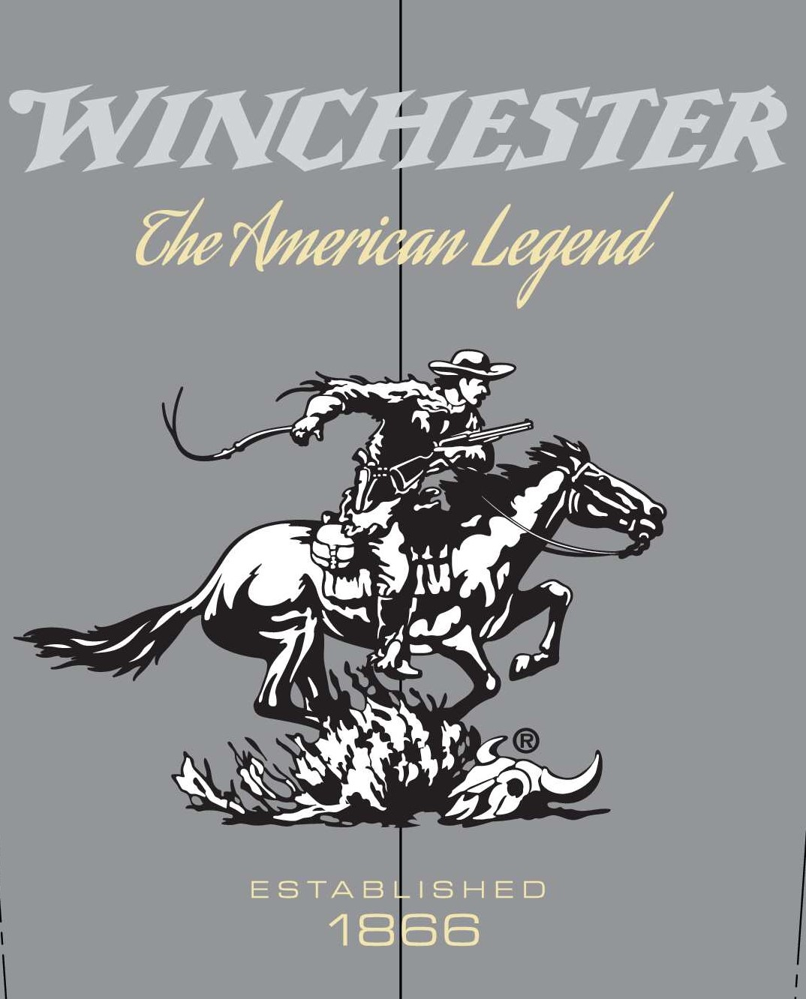

# TTB COLA Label Images - TTBID 26295001000748

**Brand Name:** WINCHESTER

**Issue Date:** 10/29/2026

**Origin Code:** 04

**Product Class/Type:** 101

**Source:** [TTB Public COLA Registry](https://ttbonline.gov/colasonline/viewColaDetails.do?action=publicFormDisplay&ttbid=26295001000748)

## Label Images

### Back Label

### Front Label

### Label 4

## Extracted Label Text

*Text extracted via OCR - may contain errors*

*1 image(s) excluded: text did not meet readability threshold*

### Back Label

DOUBLE OAKED

Kentucky Straight Bourbon Whiskey

BATCH NO.

BOTTLE NO.

### Front Label

WINCHESTER
The Ameriean Legend
ESTABLISHED
18666
