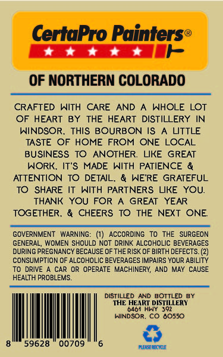

# TTB COLA Label Images - TTBID 26295001000834

**Brand Name:** THE HEART DISTILLERY

**Fanciful Name:** CERTA PRO STRAIGHT BOURBON

**Issue Date:** 10/27/2026

**Origin Code:** 13

**Product Class/Type:** 101

**Source:** [TTB Public COLA Registry](https://ttbonline.gov/colasonline/viewColaDetails.do?action=publicFormDisplay&ttbid=26295001000834)

## Label Images

### Back Label

## Extracted Label Text

*Text extracted via OCR - may contain errors*

### Back Label

CertaPro Painters®

EEE

OF NORTHERN COLORADO

CRAFTED WITH CARE AND A WHOLE LOT

OF HEART BY THE HEART DISTILLERY IN

WINDSOR. THIS BOURBON IS A LITTLE

TASTE OF HOME FROM ONE LOCAL

BUSINESS TO ANOTHER. LIKE GREAT

WORK. IT'S MADE WITH PATIENCE &

ATTENTION TO DETAIL. & WE'RE GRATEFUL

TO SHARE IT WITH PARTNERS LIKE YOU.

THANK YOU FOR A GREAT YEAR

TOGETHER. & CHEERS TO THE NEXT ONE.

GOVERNMENT WARNING: (1) ACCORDING TO THE SURGEON

GENERAL, WOMEN SHOULD NOT DRINK ALCOHOLIC BEVERAGES

DURING PREGNANCY BECAUSE OF THE RISK OF BIRTH DEFECTS. (2)

CONSUMPTION OF ALCOHOLIC BEVERAGES IMPAIRS YOUR ABILITY

TO DRIVE A CAR OR OPERATE MACHINERY, AND MAY CAUSE

HEALTH PROBLEMS,

DISTILLED AND BOTTLED BY

THE HEANT DISTILLERY

hanson. Co 60380

TT ea

>
