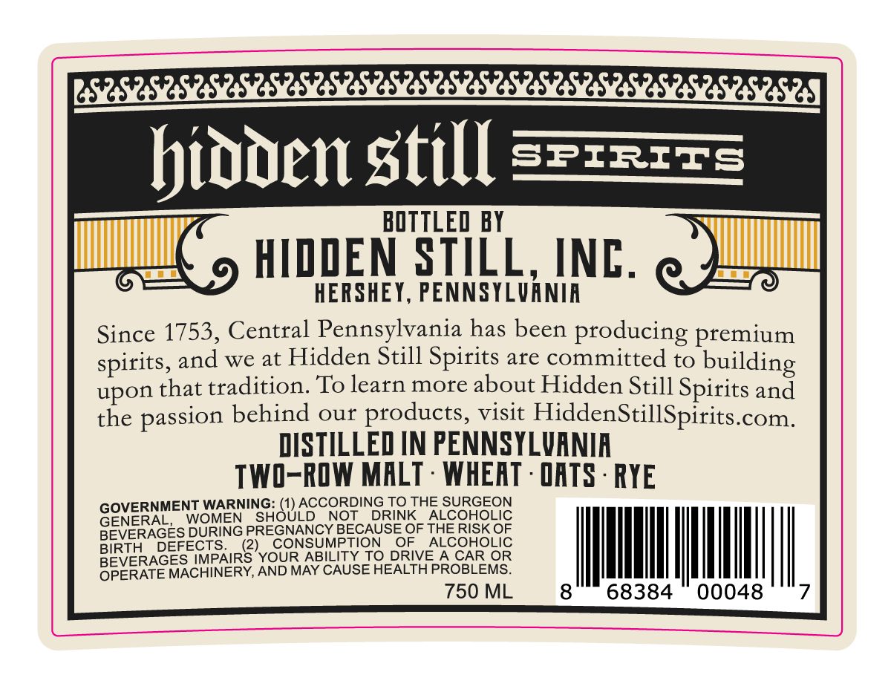
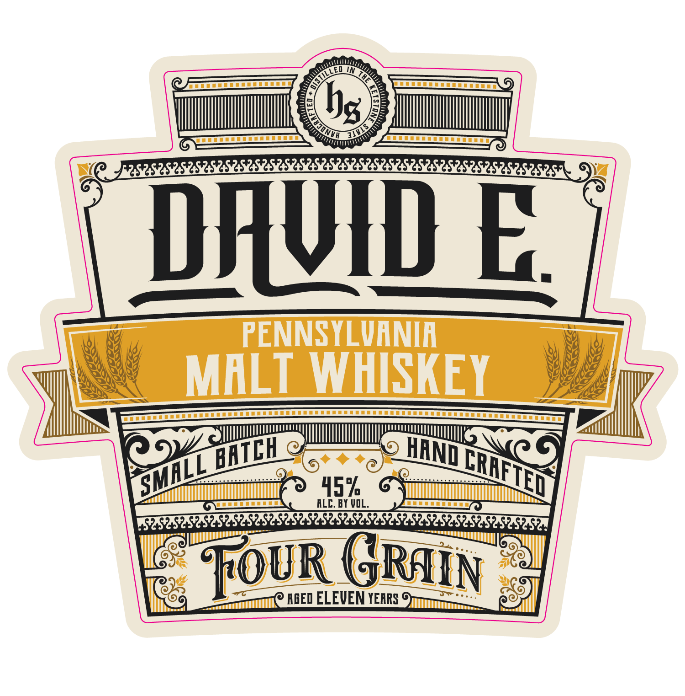

# TTB COLA Label Images - TTBID 26296001000012

**Brand Name:** DAVID E.

**Issue Date:** 11/04/2026

**Origin Code:** 39

**Product Class/Type:** 118

**Source:** [TTB Public COLA Registry](https://ttbonline.gov/colasonline/viewColaDetails.do?action=publicFormDisplay&ttbid=26296001000012)

## Label Images

### Back Label

### Front Label

## Extracted Label Text

*Text extracted via OCR - may contain errors*

### Back Label

bioden still
S7t257S
BOTTLED BY
HIDDEN STILL
INC.
HERSHEY, PENNSYLVANIA
Since 1753, Central Pennsylvania has been producing premium
spirits, and we at Hidden Still Spirits are committed to
building
upon that tradition; To learn more about Hidden Still Spirits and
the
behind our products, visit
HiddenStillSpirits
com_
DISTILLED IN PENNSYLVANIR
TWI-ROW MALT
WHEAT . QATS . RYE
GOVERNMENT WARNING;
GiOUACCOBDINSRTIHE SLRGGOC
GENERALL
WOMEN
NOT
DRINK
ALCOHOLIC
BEVERAGES DURING PRECNANCY BECAUSEOF THERISR OF
BIRTH
DEFECTS_
2)
CONSUMPTION
OF
ALCOHOLIC
BEVERAGES IMPAIRS YOUR ABILITIX TO DRIVEA CAR OR
OPERATE MACHINERY, AND MAY CAUSE HEALTH PROBLEMS_
750 ML
68384
00048
passion

### Front Label

hs
DWDE
PENNSYLVANIA
MALT WHISKEY
452
ALC; BY VOL.
S2s2
2S251
S4S
52222
TOuR GRAIN
AGED ELEVEN YEARS
BHTCH
HAND
CAAFTED
SMALL
