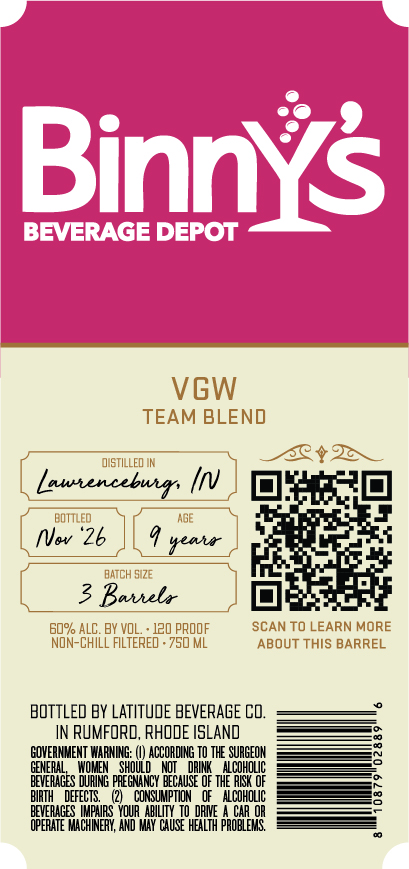
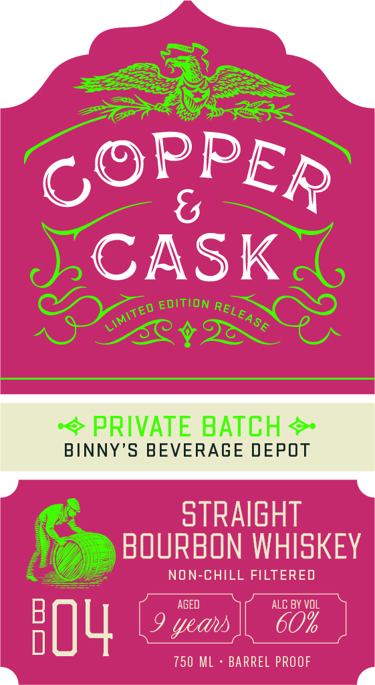

# TTB COLA Label Images - TTBID 26296001000094

**Brand Name:** COPPER & CASK

**Fanciful Name:** BD-04

**Issue Date:** 10/27/2026

**Origin Code:** 40

**Product Class/Type:** 101

**Source:** [TTB Public COLA Registry](https://ttbonline.gov/colasonline/viewColaDetails.do?action=publicFormDisplay&ttbid=26296001000094)

## Label Images

### Back Label

### Front Label

### Label 3

## Extracted Label Text

*Text extracted via OCR - may contain errors*

**Detected Proof:** 120

### Back Label

Binnys
BEVERAGE DEPOT
VGW
TEAM BLEND
dISTILLED IN
Luutencebur: In
BOtTled
AGE
NVwv '26
seala
BATCH 5IzE
3 Baiiela
60% ALC. BY VOL.
120 pROOF
SCAN TO LEARN MORE
NOn-ChILL FILTERED . 750 ML
ABOUT THIS BARREL
BOTTLED BY LATITUDE BEVERAGE Cd.
IN RUMFORD, RHODE ISLAND
GOVERNMENT WARNING:
ACCORDING TO
SURGEOH
GENERAD
E
SHOUL
DHI
ALCOHOLIC
BEVERAGES
PREGNANCY BECAUSE OF thE RESK OF
BIRTH
DEFECTS.
CONSUMPTION   Of   Alcoholic
PEVERAGES LIPARS YQURAbIViy
Daie
CAR OR
OPERATE MACHINERY, AND MAY CHuse HEALTH PROBLEYG

### Front Label

C
CASK
EDITION
EA
S6
PRIVATE BATCH
BINNY'S BEVERAGE DEPOT
stRAIGHT
BOURBON WHISKEY
NON-CHILL FILTERED
AGED
ALC BY voL
8O4
9 yeaus
750 ML
BARREL PROOF
PPER
RELI
LIMITED

### Label 3

COPPER & CASK Say

MSW 8 WdddOd

a=
