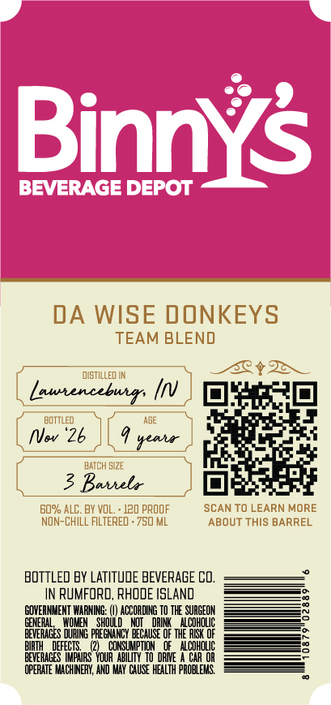
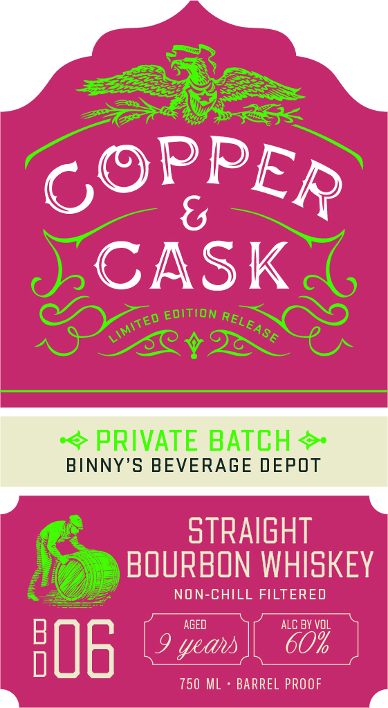

# TTB COLA Label Images - TTBID 26296001000109

**Brand Name:** COPPER & CASK

**Fanciful Name:** BD-06

**Issue Date:** 10/27/2026

**Origin Code:** 40

**Product Class/Type:** 101

**Source:** [TTB Public COLA Registry](https://ttbonline.gov/colasonline/viewColaDetails.do?action=publicFormDisplay&ttbid=26296001000109)

## Label Images

### Back Label

### Front Label

### Label 3

## Extracted Label Text

*Text extracted via OCR - may contain errors*

**Detected Proof:** 120

### Back Label

Binnys
BEVERAGE DEPOT
DA WISE DONKEYS
TEAM BLEND
DISTILLED IN
Launencebuir;
BDTTLED
AGE
NVwv '26
seata
BATCH SIZE
3 Baniela
60% ALC. BY VOL
120 pROOF
SCAN TO LEARN MORE
NON-ChILL FILTERED . 750 ML
ABOUT ThIS BARREL
BOTTLED BY LATITUDE BEVERAGE CO,
In RUMFORD, RHODE ISLAnD
GOVERNMENT WARNING:
ACCORDING
THE SURGEON
GENERAD
E
SHOUL
DHI
ALCOHOLIC
BEVERAGES
PREGNHNCY BECAUSE OF thE AESK OF
EFECIS
CONSUMPTION
ALCOHOLIC
BEVERAGES TPARS" YOUR  ABILITY
DRME
CAR OR
OPERATE MACHINERY; AND MAY CAUsE HEALTH PROBLEMS

### Front Label

CASK
EDITION
EA
Sc
PRIVATE BATCH
BINNY'S BEVERAGE DEPOT
stRAIGHT
BOURBON WHISKEY
NON-CHILL FILTERED
AGED
ALC BY VoL
HOE
9 yeaus
750 ML
BARREL PROOF
PPER
GC
RELI
LIMITED

### Label 3

COPPER & CASK Say

MSW 8 WdddOd

a=
