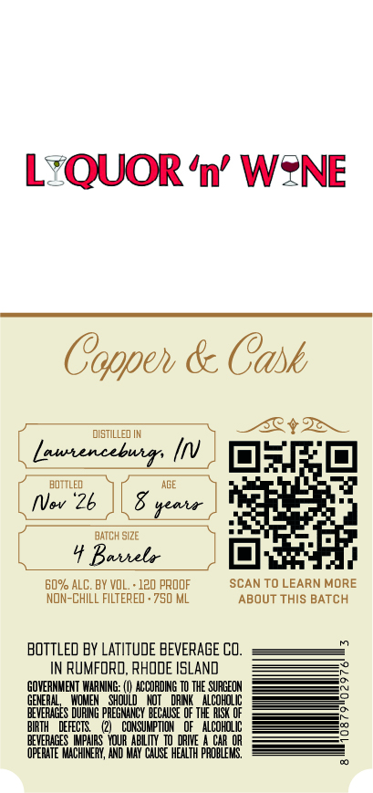
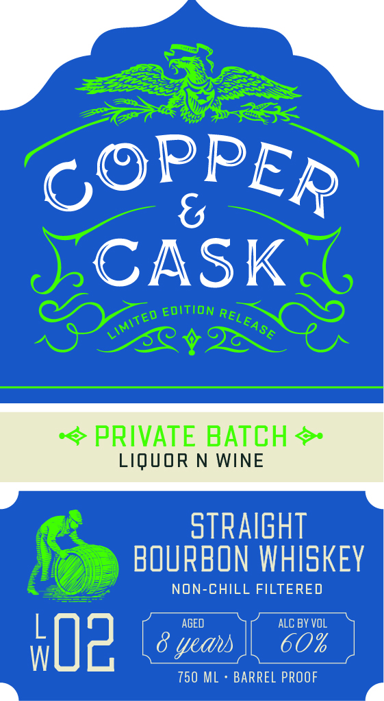
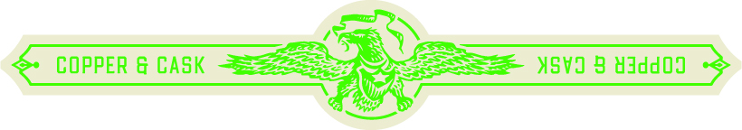

# TTB COLA Label Images - TTBID 26296001000114

**Brand Name:** COPPER & CASK

**Fanciful Name:** LW-02

**Issue Date:** 10/29/2026

**Origin Code:** 40

**Product Class/Type:** 101

**Source:** [TTB Public COLA Registry](https://ttbonline.gov/colasonline/viewColaDetails.do?action=publicFormDisplay&ttbid=26296001000114)

## Label Images

### Back Label

### Front Label

### Label 3

## Extracted Label Text

*Text extracted via OCR - may contain errors*

**Detected Proof:** 120

### Back Label

QUOR 'n' WZNE
Coppeh & Cask
distILled IM
Lautencebuirs
BOTTLED
AGE
NVev '26
BATCH SiZE
Bathelx
60% ALC. BY VOL
120 pROOF
SCAN TO LEARN MORE
NON-ChILL FILTERED . 750 ML
ABOUT ThiS BATCH
BOTTLEO BY LATITUDE BEVERAGE CO_
IN RuMFORD, RHODE ISLANd
GOVERNMENT WARMING:
ACCORDIG TO THE SURGEON
GENERE
SHOULD
DRINK ` ALCOHOLIc
BEVERACES
ERe
PREGNHNCY BECAUSE @F THE RISK OF
BIRTH
DEFECTS
CONSUMPTIOH
OF   ALCOHOLIc
BEVERAGES WPARS  VQUR AbllIi
DRIVE
CAR OR
OPERATE MACHINERY, ANd MAY  Chuse HEALTH PROBLEHIS,
#e1

### Front Label

CASK
EDITION
PRIVATE BATCH
LIQUOR N WINE
stRAIgHT
BOURBON WHISKEY
NON-CHILL FILTERED
AGED
ALC BY vOL
koz
yeau
%
750 ML
BARREL PROOF
PPER
6@
RELEASE
LIMITED

### Label 3

COPPER & CASK Say

MSW 8 WdddOd

a=
