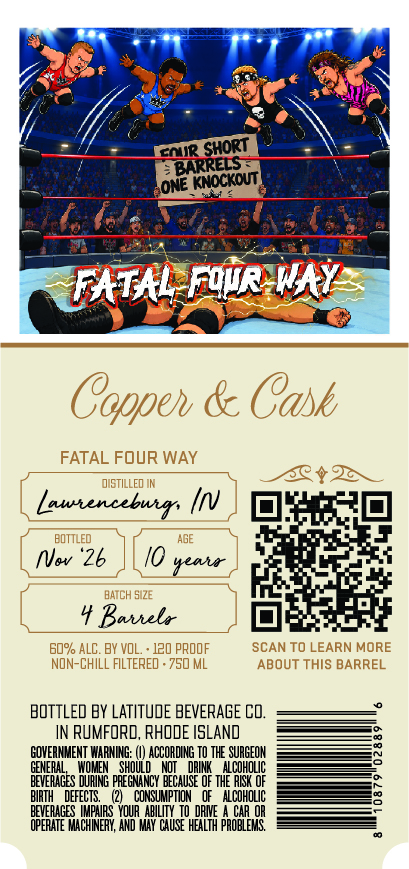
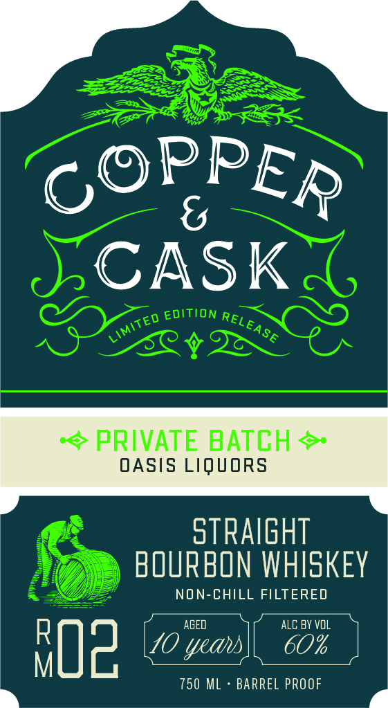

# TTB COLA Label Images - TTBID 26296001000118

**Brand Name:** COPPER & CASK

**Fanciful Name:** RM-02

**Issue Date:** 10/29/2026

**Origin Code:** 40

**Product Class/Type:** 101

**Source:** [TTB Public COLA Registry](https://ttbonline.gov/colasonline/viewColaDetails.do?action=publicFormDisplay&ttbid=26296001000118)

## Label Images

### Back Label

### Front Label

### Label 3

## Extracted Label Text

*Text extracted via OCR - may contain errors*

**Detected Proof:** 120

### Back Label

FOR
ONEtocxout
FATAL Fuir WAY
Coppeh & Cask
FATAL FOUR WAY
dIstILLED IN
Launenceburs
BOTTLED
NVwv "26
seata
BATCH SI2E
Batiele
60% ALC. BY VOL.
120 pROOF
SCAN TO LEARN MORE
NON-ChILL FILTERED . 750 ML
ABOUT THIS BARREL
BOTTLED BY LATITUDE BEVERAGE Cd.
IN RUMFORD, RHODE ISLAND
GOVERNMENT WARNING:
ACCORDING TO THE SURGEOH
GENERAD
SHOUL
DHI
ALCOHOLIC
BEVERAGES
E
PREGNANCY BECAUSE OF thE RESK OF
BIRTH
DEFECTS
CONSUMPTION   Of   Alcoholic
BEVERAGES IMIPAIRS  VOUR  abilITY
Daie
CAR OR
OPERATE MACHINERY, AND MAY CHuse HEALTH PROBLEYG
IShoRT
BARRELS

### Front Label

CASK
EDITION
PRIVATE BATCH
OASIS LIQUORS
straight
BOURBON WHISKEY
NON-CHILL FILTERED
AGED
ALC BY vOL
p0z
RI
10
750 ML
BARREL PROOF
PPER
6@
RELEASE
LIMITED
yeau

### Label 3

COPPER & CASK Say

MSW 8 WdddOd

a=
