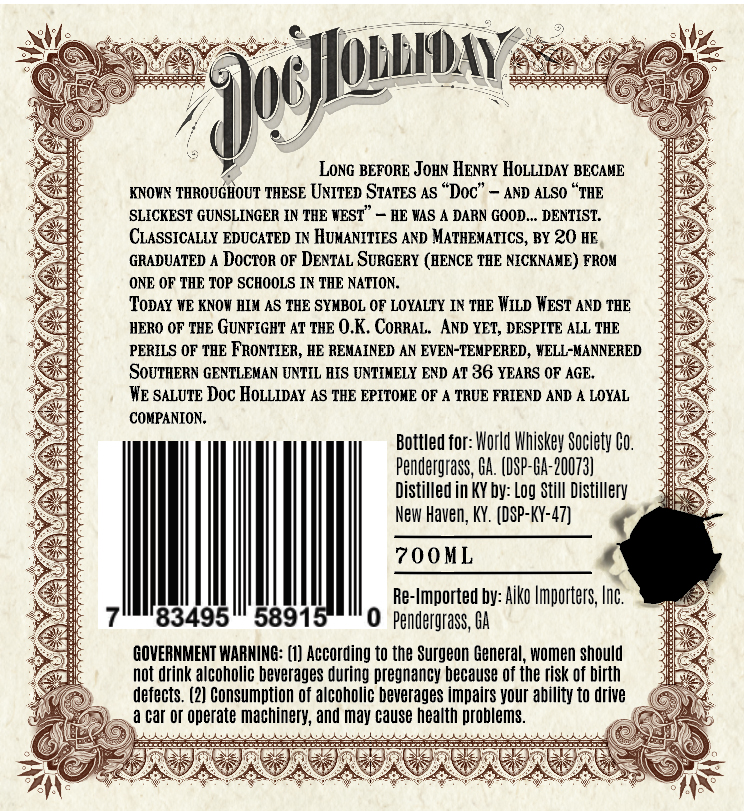
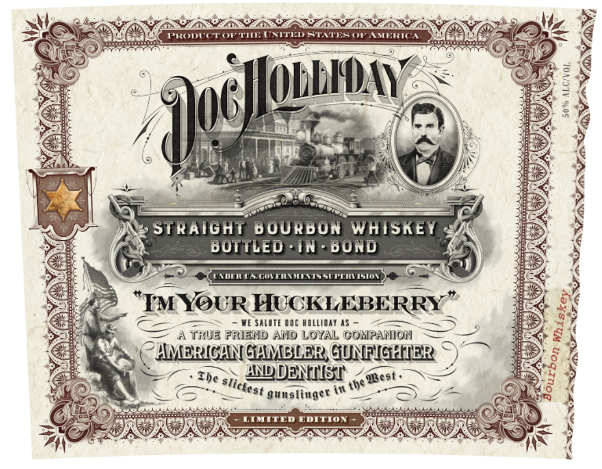

# TTB COLA Label Images - TTBID 26296001000184

**Brand Name:** DOC HOLLIDAY

**Issue Date:** 10/27/2026

**Origin Code:** 22

**Product Class/Type:** 101

**Source:** [TTB Public COLA Registry](https://ttbonline.gov/colasonline/viewColaDetails.do?action=publicFormDisplay&ttbid=26296001000184)

## Label Images

### Back Label

### Front Label

## Extracted Label Text

*Text extracted via OCR - may contain errors*

**Detected Age:** 36 Years

### Back Label

Ilodbiay
LoNG BEFORE JoHn HENRY HoLLIDAY BECAME
KNOWN THROUGHOUT THESE UJNITED STATES AS "Doc'
AND ALSO `THE
SLICKEST GUNSLINGER IN THE WEST"
HE WAS 4 DARN GOOD _ DENTIST
CLASSICALLY EDUCATED IN HUMANITIFS AND MATHEMATICS, BY 20 HE
GRADUATED ^ DOcTOR OF DENTAL SURGERY (HENCE THE NICKNAME) FROM
ONE OF THE TOP SCHOOLS IN THE NATION:
ToDaY WE KNOW HIM AS THE SYMBOL OF LOYALTY IN TBE WILD HEST AND THE
HERO OF THE GUNFIGHT AT THE 0.K. CORRAL   ANd YET; DESPITE ALL THE
PERILS OF THE FRONTIER, HE REMAINED AN EVEN-TEMPERED , WELL-MANNERED
SouTHERN GENTLEMAN UNTIL AIS UNTIMELY END AT 36 YEARS OF AGE
We SALUTE Doc HoLLIDAY AS THE EPITOME OF A TRUE FRIEND AND
LOYAL
COMPANION_
Bottled for: World Whiskey Society Co,
Pendergrass; G4: (DSP-Oa:20073)
Distilled in KY by: Log Still Distillery
New Haven; KY. (DSP-KY-47)]
700 ML
Re-Imported by: Aiko Importers, Inc
83495
58915
0  Pendergrass; GA
GOVERNMENT WARNING: (1) According to the Surgeon General, women should
not drink alcoholic beverages during pregnancy because of the risk of birth
defects. (2] Consumption of alcoholic beverages impairs your ability to drive
car Or operate machinery; and may cause health problems.

### Front Label

PRODUCTOF THE UMITED STTESOF AMERICA
IlobbiDay
1
6
STRAIGHT B OURBON WHISKEY
BOTTLED
IN
BOND
ULdcR VS GOVIRINLLTSSUPERVISION
IMYOUR HUCKLEBERRY
We SALITE I0c holliday As
TrUe FRIEND AND LOYAL COMPANION
HERICANGAMBLER GUNFIGHHIER
ANDDENIST'
i# the
gunslinger
LIMITED EDITION
9106)
1
1
Ihe
Qbest _
slictest
