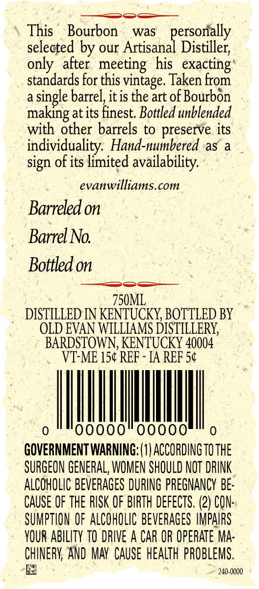
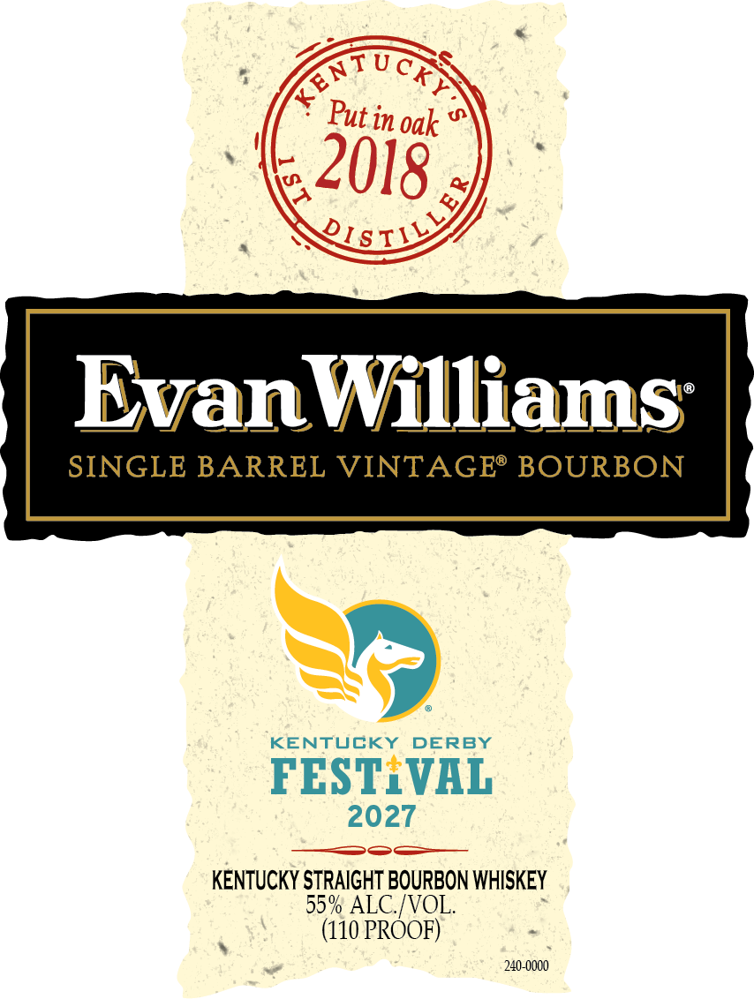

# TTB COLA Label Images - TTBID 26296001000210

**Brand Name:** EVAN WILLIAMS

**Fanciful Name:** KENTUCKY DERBY FESTIVAL

**Issue Date:** 10/29/2026

**Origin Code:** 22

**Product Class/Type:** 101

**Source:** [TTB Public COLA Registry](https://ttbonline.gov/colasonline/viewColaDetails.do?action=publicFormDisplay&ttbid=26296001000210)

## Label Images

### Back Label

### Label 1

## Extracted Label Text

*Text extracted via OCR - may contain errors*

**Detected Proof:** 110

### Back Label

This
Bourbon
was
personally
selected by our Artisanal Distiller;
only
after   meeting   his_ exacting
standards for this vintage. Taken From
a
single barrel,it is the
of Bourbon
making at its finest Bottled unblended
with other barrels to preserve its
individuality: Hand-numbered as
sign of its limited availability:
evanwilliams com
Barreled on
Barrel No
Bottled on
750ML
DISTILLED IN KENTUCKY, BOTTLED BY
OLD EVAN WILLIAMS DISTILLERY;
BARDSTOWN, KENTUCKY 40004
VT-ME 154 REF
IA REF 5c
00000
GOVERNMENT WARNING; (0| ACCORDING TO THE
SURGEON GENERAL, WOMEN SHOULD NOT DRINK
ALCOHOLIC BEVERAGES DURING PREGNANCY BE:
CAuSe OF ThE RISK OF BIRTH DEFECTS. (2) CON:
SUMPTHON OF ALCOhOLIC BEVERAGES HMPAIRS
YOUR ABILITY TO DRIVE A CAR OR OPERATE MA:
CHINERV; AND MAY CAuSe hEalth PROBLEMS.
240-0000
art

### Label 1

in oak
EvanWilliams_
SINGLE BARREL VINTAGE" BOURBON
KENTUCKY
DERBY
FEST VAL
2027
KENTUCKY STRAIGHT BOURBON WHISKEY
55% ALC/VOL.
(110 PROOF)
240-0000
STucky
1
Put :
2018
QIsILLEY
