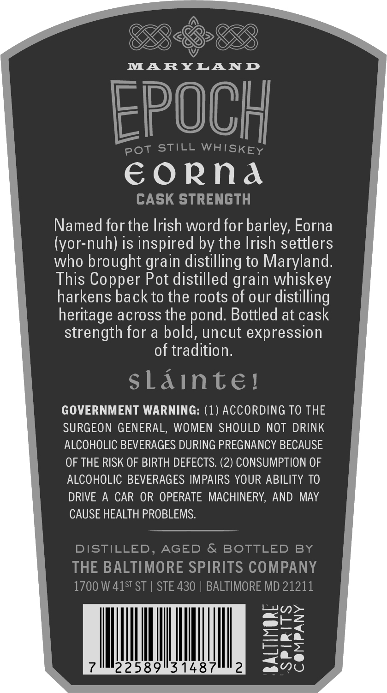
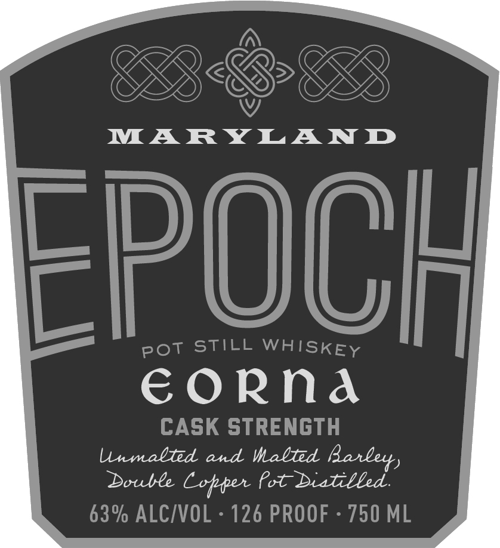

# TTB COLA Label Images - TTBID 26296001000230

**Brand Name:** EPOCH

**Issue Date:** 10/29/2026

**Origin Code:** 25

**Product Class/Type:** 140

**Source:** [TTB Public COLA Registry](https://ttbonline.gov/colasonline/viewColaDetails.do?action=publicFormDisplay&ttbid=26296001000230)

## Label Images

### Back Label

### Front Label

### Label 2

## Extracted Label Text

*Text extracted via OCR - may contain errors*

*1 image(s) excluded: text did not meet readability threshold*

**Detected Proof:** 126

### Back Label

SESE

MARYLAND

EPOC},

pot STILL WHISKEy

EORNA

CASK STRENGTH

Named for the Irish word for barley, Eorna

(yor-nuh) is inspired by the Irish settlers

who brought grain distilling to Maryland

This Copper Pot distilled grain whiskey

harkens back to the roots of our distilling

heritage across the pond. Bottled at cask

strength for a bold, uncut expression

of tradition

sLainte

GOVERNMENT WARNING: (1) ACCORDING TO THE

SURGEON GENERAL, WOMEN SHOULD NOT DRINK

ALCOHOLIC BEVERAGES DURING PREGNANCY BECAUSE

OF THE RISK OF BIRTH DEFECTS. (2) CONSUMPTION OF

ALCOHOLIC BEVERAGES IMPAIRS YOUR ABILITY TO

DRIVE A CAR OR OPERATE MACHINERY, AND MAY

CAUSE HEALTH PROBLEMS.

DISTILLED, AGED & BOTTLED BY

THE BALTIMORE SPIRITS COMPANY

1700 W 415" ST | STE 430 | BALTIMORE MD 21211

Lan>

e@tl=

=«<a

a

|

hh

eae

22589531487

aa

### Front Label

MARYLAND
EpOCH
STILL WHISKEY
€oRna
CASK STRENGTH
lnmalted and Malted
Double
Cotper ?ot Dialilled
63% ALCIVOL
126 PROOF
750 ML
Pot
Banlerr)
