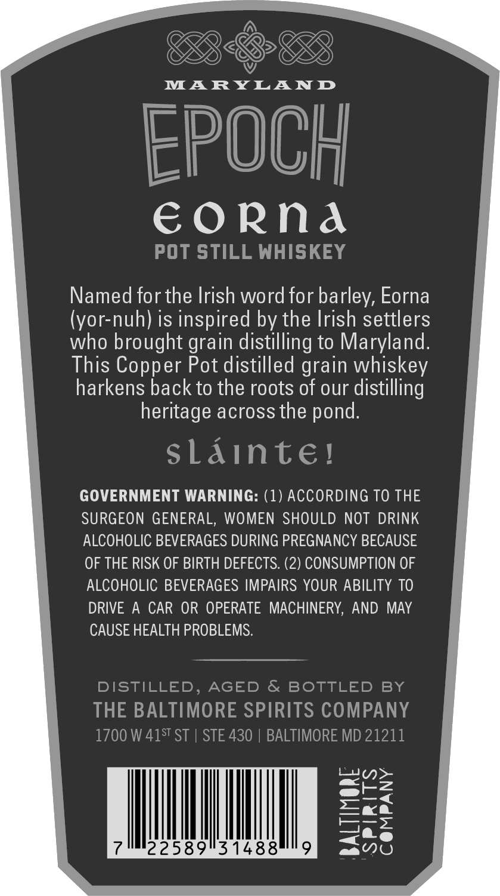
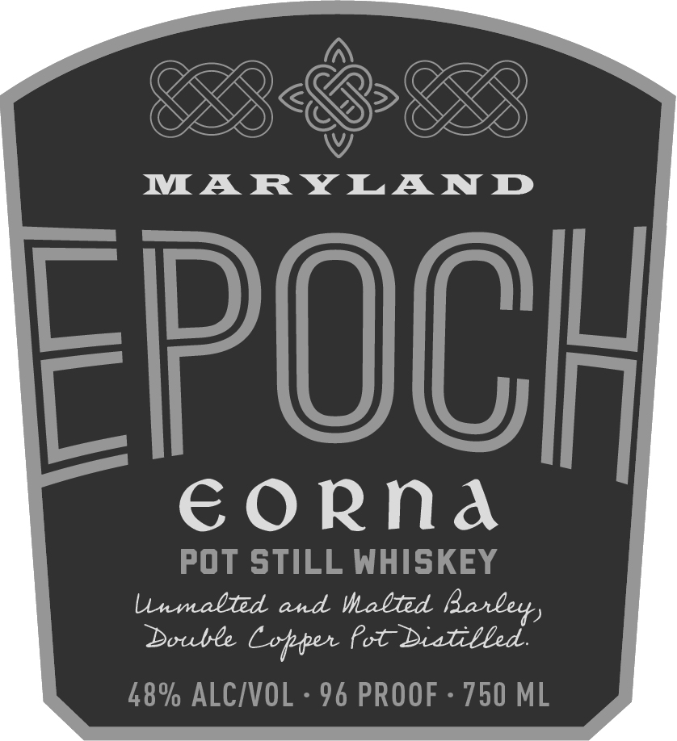

# TTB COLA Label Images - TTBID 26296001000238

**Brand Name:** EPOCH

**Issue Date:** 10/27/2026

**Origin Code:** 25

**Product Class/Type:** 140

**Source:** [TTB Public COLA Registry](https://ttbonline.gov/colasonline/viewColaDetails.do?action=publicFormDisplay&ttbid=26296001000238)

## Label Images

### Back Label

### Front Label

### Label 3

## Extracted Label Text

*Text extracted via OCR - may contain errors*

*1 image(s) excluded: text did not meet readability threshold*

**Detected Proof:** 96

### Back Label

MARYLAND

EPOCH

EORNA

POT STILL WHISKEY

Named for the Irish word for barley, Eorna
(yor-nuh) is inspired by the Irish settlers
who brought grain distilling to Maryland.
This Copper Pot distilled grain whiskey
harkens back to the roots of our distilling
heritage across the pond.

sLAINtE!

GOVERNMENT WARNING: (1) ACCORDING TO THE
SURGEON GENERAL, WOMEN SHOULD NOT DRINK
ALCOHOLIC BEVERAGES DURING PREGNANCY BECAUSE
OF THE RISK OF BIRTH DEFECTS. (2) CONSUMPTION OF
ALCOHOLIC BEVERAGES IMPAIRS YOUR ABILITY TO

DRIVE A CAR OR OPERATE MACHINERY, AND MAY
CAUSE HEALTH PROBLEMS.

DISTILLED, AGED & BOTTLED BY
THE BALTIMORE SPIRITS COMPANY
700 W 415" ST | STE 430 | BALTIMORE MD 21211

7225899314889

### Front Label

MARYLAND
FpoCH
€orna
POt STILL WHISKEY
lnmalted and Malted
Double
Lotper Pot
T Bieted
48% ALCIVOL
96 PROOF
750 ML
