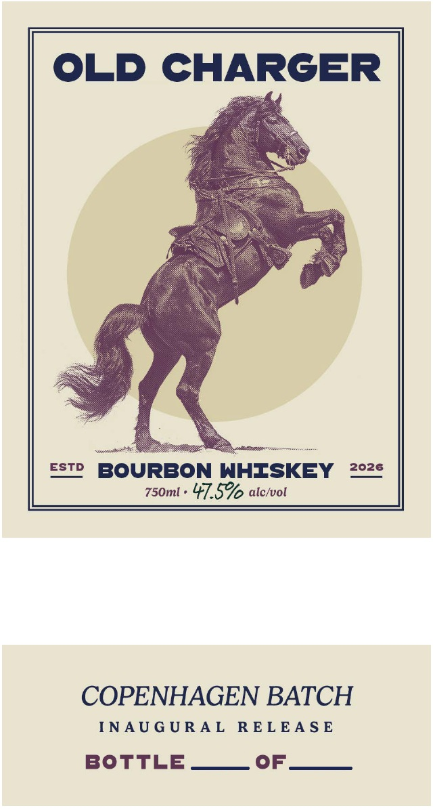
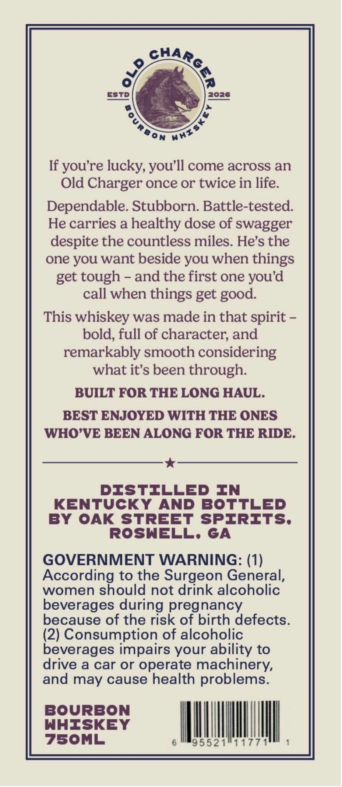

# TTB COLA Label Images - TTBID 26296001000352

**Brand Name:** OLD CHARGER

**Issue Date:** 10/30/2026

**Origin Code:** 08

**Product Class/Type:** 141

**Source:** [TTB Public COLA Registry](https://ttbonline.gov/colasonline/viewColaDetails.do?action=publicFormDisplay&ttbid=26296001000352)

## Label Images

### Front Label

### Label 2

## Extracted Label Text

*Text extracted via OCR - may contain errors*

**Detected Proof:** 95

### Front Label

OLD CHARGER

SS

sonnet

est? BOU

RBON WHISKEY ze38

50m » 47.5% alcivol

COPENHAGEN BATCH

INAUGURAL RELEASE

BOTTLE

OF

### Label 2

CHAR,

ESTD

2026

eon mee

If you’re lucky, you’ll come across an

Old Charger once or twice in life

Dependable. Stubborn. Battle-tested.

He carries a healthy dose of swagger

despite the countless miles. He’s the

one you want beside you when things

get tough - and the first one you’d

call when things get good.

This whiskey was made in that spirit -

bold, full of character, and

remarkably smooth considering

what it’s been through

BUILT FOR THE LONG HAUL

BEST ENJOYED WITH THE ONES

WHO’VE BEEN ALONG FOR THE RIDE

*

DISTILLED IN

KENTUCKY AND BOTTLED

BY OAK STREET SPIRITS.

ROSWELL, GA

GOVERNMENT WARNING: (1)

According to the Surgeon General

women should not drink alcoholic

beverages during pregnancy

because of the risk of birth defects

(2) Consumption of alcoholic

beverages impairs your ability to

drive a car or operate machinery,

and may cause health problems

BOURBON

WHISKEY

7S5OML

AMM

95521

ieee

ill
