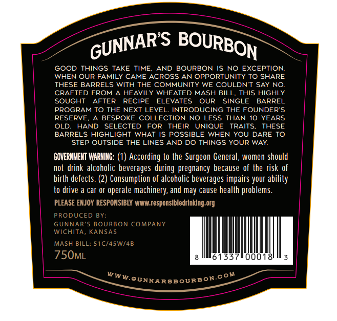
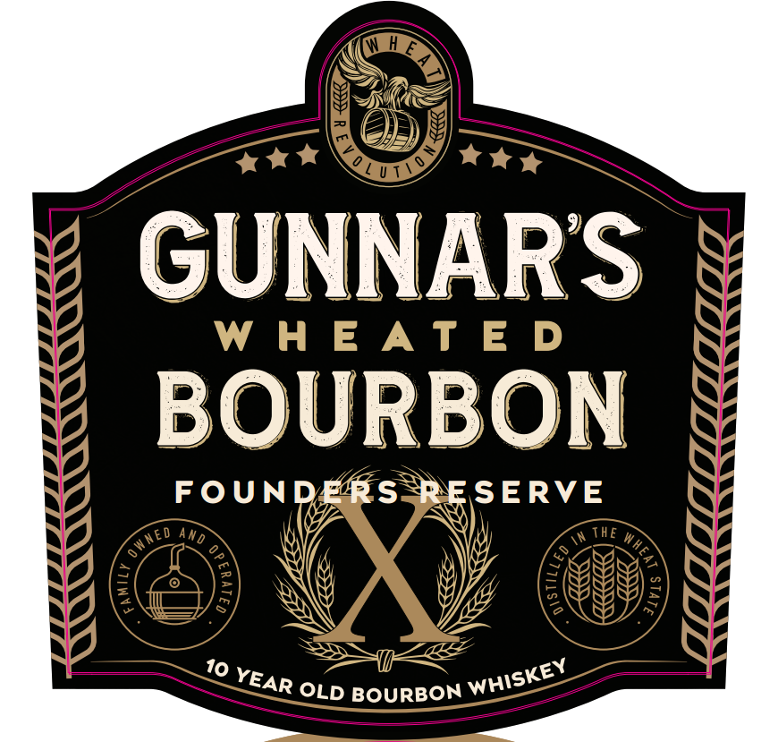
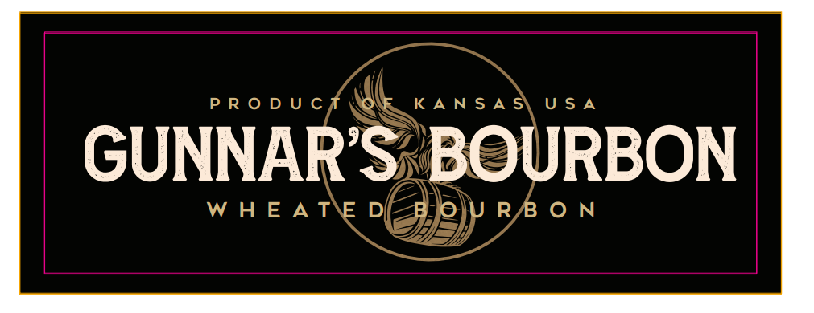
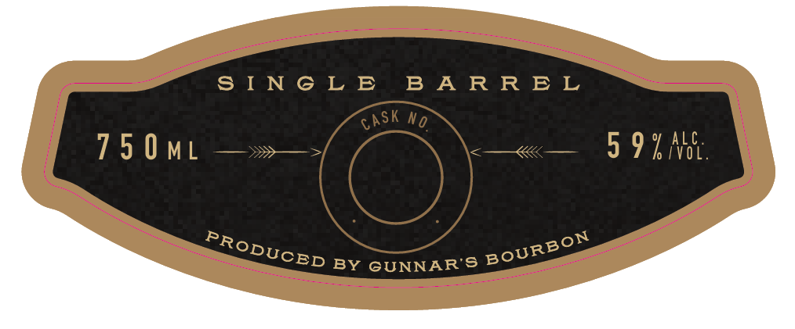

# TTB COLA Label Images - TTBID 26296001000414

**Brand Name:** GUNNAR'S WHEATED BOURBON

**Fanciful Name:** FOUNDER'S RESERVE

**Issue Date:** 11/04/2026

**Origin Code:** 21

**Product Class/Type:** 141

**Source:** [TTB Public COLA Registry](https://ttbonline.gov/colasonline/viewColaDetails.do?action=publicFormDisplay&ttbid=26296001000414)

## Label Images

### Back Label

### Front Label

### Label 2

### Label 4

## Extracted Label Text

*Text extracted via OCR - may contain errors*

*2 image(s) excluded: text did not meet readability threshold*

**Detected Age:** 10 Years

### Back Label

GOOD THINGS
TAKE
TIME
AND BOURBON IS
NO EXCEPTION
WHEN OUR FAMILY CAME
ACROSS AN OPPORTUNITY TO SHARE
THESE BARRELS WITH THE COMMUNITY WE COULDNT SAY NO
CRAFTED FROM A HEAVILY
WHEATED MASH BILL
This HIGHLY
SOUGHT
AFTER
RECIPE
ELEVATES
OUR
SINGLE
BARREL
PROGRAM TO THE NEXT LEVEL
INTRODUCING THE FOUNDERS
RESERVE;
BESPOKE COLLECTION NO LESS
THAN 10 YEARS
OLD
HAND
SELECTED
FOR
THEIR
UNIQUE
TRAITS
THESE
BARRELS HIGHLIGHT WHAT IS POSSIBLE WHEN YOU DARE TO
STEP OUTSIDE THE LINES AND DO THINGS YOUR WAY
GOVERNMEHT WARHNG: (1) According to the Surgeon General, women should
not drink  alcoholic beverages during pregnancy because of the risk of
birth defects
Consumption of alcoholic beverages impairs your ability
to drive
car Or
operate machinery; and may cause health problems.
PLEASE ENJOY RESPONSIBLY WWW responslbledrlnklog org
PRODUCED
BY:
GUNNAR'$ BOURBON COMPANY
WICHITA
KANSAS
MASH BILL: 51C/45W/4B
75OML
33
00018
GUNNARBBOURBON.
GUNNARS
BOURBON
WWw
com

### Front Label

GUNNARS
W h E A T E D
BOURBON
FOUNDERs
RSERVE
THE
10
BOURBON
WNEd
and
1
2
1
3
3
WHISKEY
YEAR
OLD
