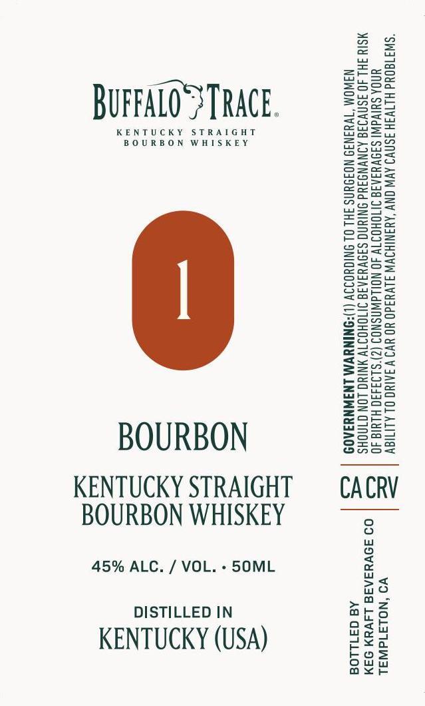

# TTB COLA Label Images - TTBID 26296001000429

**Brand Name:** BUFFALO TRACE

**Issue Date:** 10/30/2026

**Origin Code:** 01

**Product Class/Type:** 101

**Source:** [TTB Public COLA Registry](https://ttbonline.gov/colasonline/viewColaDetails.do?action=publicFormDisplay&ttbid=26296001000429)

## Label Images

### Label 1

## Extracted Label Text

*Text extracted via OCR - may contain errors*

**Detected Proof:** 90

### Label 1

Ssea

i

ZzEaeo

Saree

BUFFALO} TRACE.

=Sauw

daasx

Boe

KENTUCKY STRAIGHT

BOURBON WHISKEY

=a ne

Hiei

enS=

BOWS

So=

BSGz

Ssee>

2Zeac

Sow

Saag

enS=

wos

ASC=

Ss

o>ow

-Sre

==eoz

e625

oosz

2as2

ee

S=25=

Eeug

Sots

SSset

Suzy

sos

oS

=aG

ooo

Sa55

S2a

SSce

Zsso

pues

s=R=

e205

E=eo=

BS2eu

Geos

Sove

Boze

=Ssco

=e

Ssal

wsSee

See

BOURBON

Ons

S2ua

KENTUCKY STRAIGHT

CACRV

BOURBON WHISKEY

45% ALC. / VOL. - SOML

no

Sa

DISTILLED IN

odah

aro

dew

KENTUCKY (USA)

ouw

bos

e<a

axe
