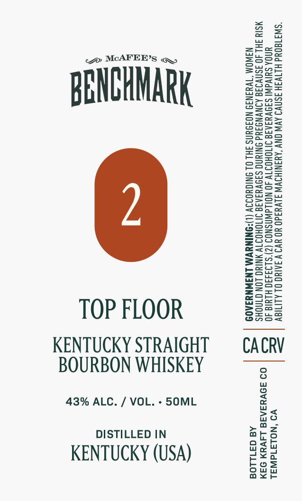

# TTB COLA Label Images - TTBID 26296001000438

**Brand Name:** MCAFEE'S BENCHMARK

**Issue Date:** 10/30/2026

**Origin Code:** 48

**Product Class/Type:** 101

**Source:** [TTB Public COLA Registry](https://ttbonline.gov/colasonline/viewColaDetails.do?action=publicFormDisplay&ttbid=26296001000438)

## Label Images

### Label 1

## Extracted Label Text

*Text extracted via OCR - may contain errors*

**Detected Proof:** 86

### Label 1

Sse

aT

ZzEaeo

Zo MCAFEER’s @,

Feer

Sun=

=Sau

p2ax

Bok

eeu

ecnaS=

BENCHMARK

BOWS

2>ne

So=

BSaz

S2e>

2Zeac

Sow

S209

enS>

ws

ASC=

Sz

o>ow

Eero

==o>

eG=a5

ons=

2as2

ee

S=se

Eeug

SS

Sorts

Snzu

sesh

eS

ae

ooo

Sa5S5

S2a

zoo

Zsso

SSae

S=G=

&@=a05

E=eco=

S2eu

Geos

Sore

Zoe

z=

=Ssco

ws

Sona

see

TOP FLOOR

Ons

S2ua

KENTUCKY STRAIGHT

CACRV

BOURBON WHISKEY

43% ALC. / VOL. - 5SOML

no

>a

DISTILLED IN

oath

ars

Wo Wy

KENTUCKY (USA)

ou

bos

e¥o

ax<r
