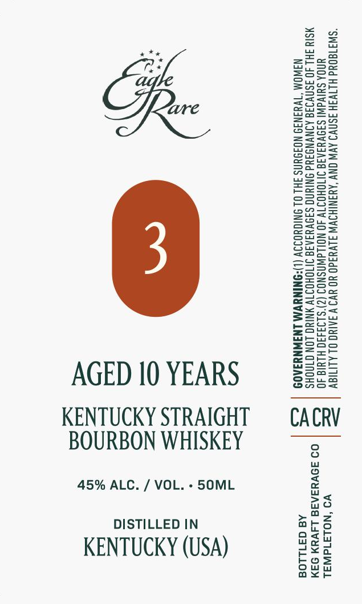

# TTB COLA Label Images - TTBID 26296001000445

**Brand Name:** EAGLE RARE

**Issue Date:** 10/29/2026

**Origin Code:** 01

**Product Class/Type:** 101

**Source:** [TTB Public COLA Registry](https://ttbonline.gov/colasonline/viewColaDetails.do?action=publicFormDisplay&ttbid=26296001000445)

## Label Images

### Label 1

## Extracted Label Text

*Text extracted via OCR - may contain errors*

**Detected Proof:** 90
**Detected Age:** 10 Years

### Label 1

*

t+

ie

aT

ZzEaeo

Feer

Sun=

Sse

=Sau

p2ax

=

25

eeu

eaS=

BOWS

B22

So=

BSeo=

S2e>

2Zeac

Seow

S209

enS>

ws

ASC=

Sz

o>ow

Eero

=s>

eG=a5

ons=

2as2

ee

S=se

Eeug

SS

Sorts

Snzu

sesh

eS

ae

ooo

Sa5S5

S2a

Za-=

Zsso

SSae

<=

&@=a05

E=eco=

eu

=<

Geos

Sore

Zoe

=Ssco

=e—

ws

Sona

see

AGED 10 YEARS

Ons

S2ua

KENTUCKY STRAIGHT

CACRV

BOURBON WHISKEY

45% ALC. / VOL. - 5SOML

>a

no

DISTILLED IN

oath

ars

af

Wo Wy

KENTUCKY (USA)

ou

os

ax<r
