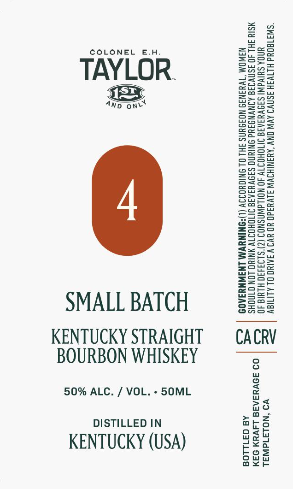

# TTB COLA Label Images - TTBID 26296001000456

**Brand Name:** COLONEL EH TAYLOR

**Issue Date:** 10/29/2026

**Origin Code:** 01

**Product Class/Type:** 101

**Source:** [TTB Public COLA Registry](https://ttbonline.gov/colasonline/viewColaDetails.do?action=publicFormDisplay&ttbid=26296001000456)

## Label Images

### Label 1

## Extracted Label Text

*Text extracted via OCR - may contain errors*

**Detected Proof:** 100

### Label 1

COLONEL E.H.

=SSa

aT

ZzEaeo

Feer

Sun=

TAYLOR.

=Sau

p2ax

Bok

eeu

ecnaS=

4p one

piss g

2Zeac

BOWS

B22

So=

BSeo=

S2e>

Seow

Saaa

enS>

ws

==o>

ASC=

Sz

o>ow

Eero

eG=a5

ons=

FSG2

ee

S=se

Eeug

SS

Sorts

Sazu

sesh

eS

ae

ooo

Sa5S5

S2a

zoo

Zsso

SSae

S=G=

&@=a05

E=eco=

S2eu

=Ssco

Geos

Sore

Zoe

Z==

ws

Sona

see

SMALL BATCH

Ons

S2ua

KENTUCKY STRAIGHT

CACRV

BOURBON WHISKEY

50% ALC. / VOL. - 50ML

no

>a

DISTILLED IN

oath

ars

e¥o

Wo Wy

KENTUCKY (USA)

ou

bos

ax<r
