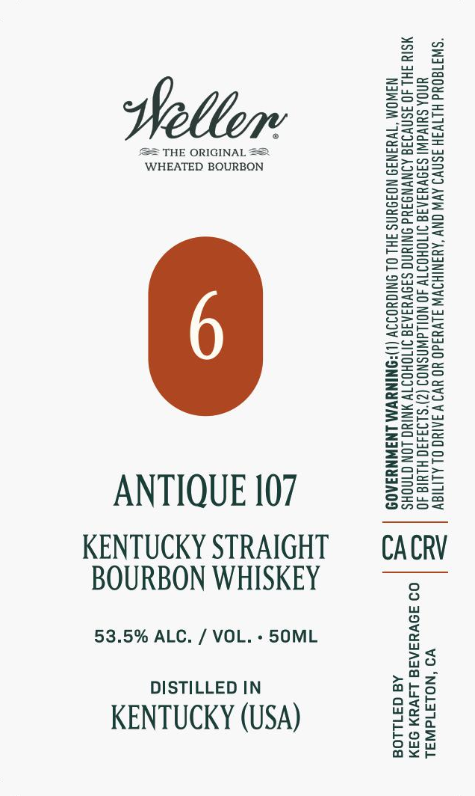

# TTB COLA Label Images - TTBID 26296001000475

**Brand Name:** WELLER

**Issue Date:** 10/30/2026

**Origin Code:** 01

**Product Class/Type:** 101

**Source:** [TTB Public COLA Registry](https://ttbonline.gov/colasonline/viewColaDetails.do?action=publicFormDisplay&ttbid=26296001000475)

## Label Images

### Label 1

## Extracted Label Text

*Text extracted via OCR - may contain errors*

**Detected Proof:** 107

### Label 1

Sse

aT

ZzEaeo

Feer

Sun=

Weller

=Sau

p2ax

Bok

== THE ORIGINAL ==

S>28

eeu

ecnaS=

WHEATED BOURBON

2Zeac

BOWS

So=

enS>

BSeo=

S2e>

Seow

S209

ws

==o>

ASC=

Sz

2as2

o>ow

Eero

eG=a5

ons=

ee

S=se

Eeug

Sorts

SScset

Snzu

sesh

eS

=ag oe

ooo

Sa5S5

S2a

zoo

Zsso

SSae

S=G=

&@=a05

E=eco=

S2eu

=Ssco

Geos

Sore

zmoe>

Z==

see

S2ua

Sona

a

ANTIQUE 107

Ons

KENTUCKY STRAIGHT

CACRV

BOURBON WHISKEY

53.5% ALC. / VOL. - 50ML

no

>a

DISTILLED IN

oath

ars

KENTUCKY (USA)

e¥o

Wo Wy

ou

bos

ax<r
