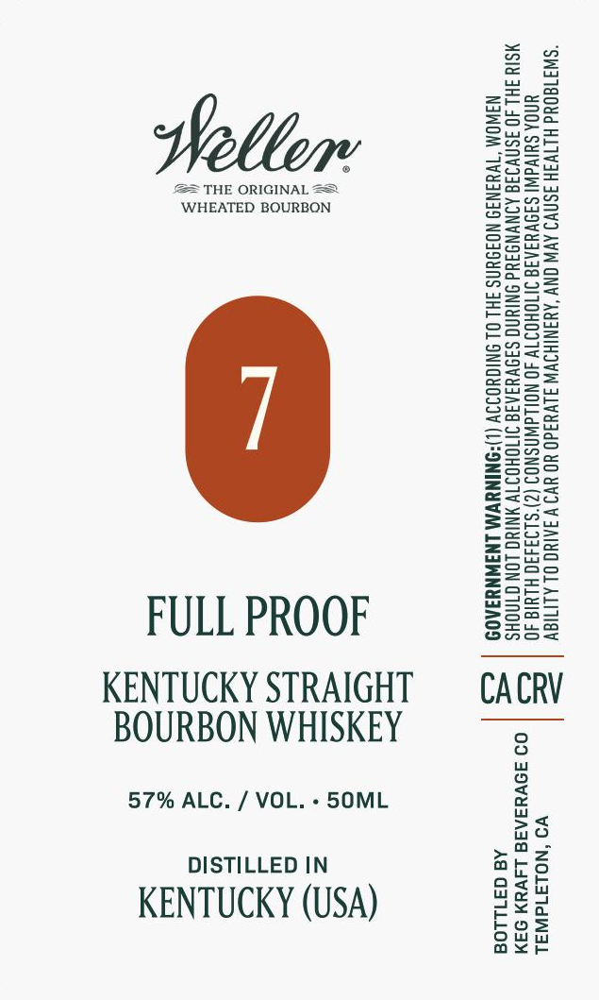

# TTB COLA Label Images - TTBID 26296001000479

**Brand Name:** WELLER

**Issue Date:** 10/28/2026

**Origin Code:** 01

**Product Class/Type:** 101

**Source:** [TTB Public COLA Registry](https://ttbonline.gov/colasonline/viewColaDetails.do?action=publicFormDisplay&ttbid=26296001000479)

## Label Images

### Label 1

## Extracted Label Text

*Text extracted via OCR - may contain errors*

**Detected Proof:** 114

### Label 1

=sSa

i

ZzEaeo

Saree

Sun=

Weller

=Seu

gazes

Boe

== THE ORIGINAL ==

eeu

ecoaS=

WHEATED BOURBON

Z2e2o

BOWS

B08

So=

BSo=

Ssee>

Seow

Saaa

enS>

wes

==oz

ASC=

Sz

o>ow

Eero

eG25

ons=

FSG2

ee

S=se

Eeug

Sots

SSset

Suzy

sesh

ee

=a oe

ooo

SS5S5

S2a

zoo

Zsso

SSe

S=G=

&@=a05

E=ecE

S2eu

=Sso

Beas

Sous

Zoe>

z==e

Sous

a

see

FULL PROOF

Ons

S2ua

KENTUCKY STRAIGHT

CACRV

BOURBON WHISKEY

57% ALC. / VOL. - 50ML

no

>a

DISTILLED IN

oath

arso

ceo

mo Wy

KENTUCKY (USA)

ou

bos

ax<r
