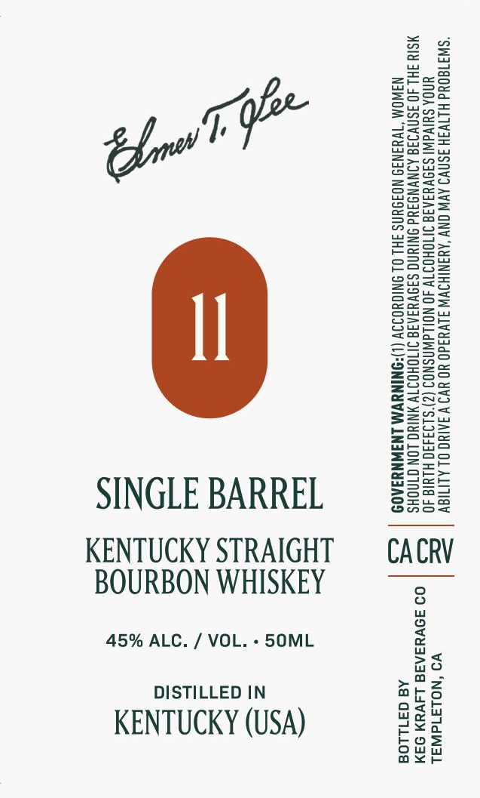

# TTB COLA Label Images - TTBID 26296001000483

**Brand Name:** ELMER T LEE

**Issue Date:** 10/28/2026

**Origin Code:** 01

**Product Class/Type:** 101

**Source:** [TTB Public COLA Registry](https://ttbonline.gov/colasonline/viewColaDetails.do?action=publicFormDisplay&ttbid=26296001000483)

## Label Images

### Label 1

## Extracted Label Text

*Text extracted via OCR - may contain errors*

**Detected Proof:** 90

### Label 1

i

ZzEaeo

Saree

Sun=

Sse

=Seu

=a

=

25

hae

eoS

eeu

Ge

BOWS

zane

So=

BSo=

Ssee>

Z2e2o

Seow

Saa09

enS>

wes

ASC=

Sz

Eero

==oz

sa

eG25

ons=

2as2

ee

S=se

Eeug

Sots

Snzu

sesh

ee

=a

ooo

SS5S5

S2a

Za-=

Zsso

SSe

<=

&@=a05

E=ecE

eu

=<

Beas

Sous

Zoe>

z==e

=Sso

Sous

a

SINGLE BARREL

Ons

S2ua

KENTUCKY STRAIGHT

CACRV

BOURBON WHISKEY

45% ALC. / VOL. - 5S0ML

>a

no

DISTILLED IN

oath

arso

mo Wy

KENTUCKY (USA)

ou

bos

ceo

ax<r
