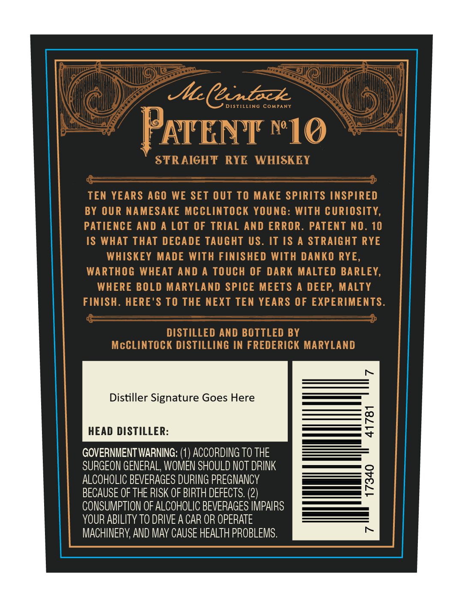
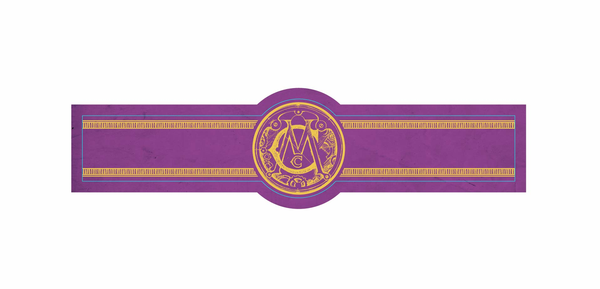
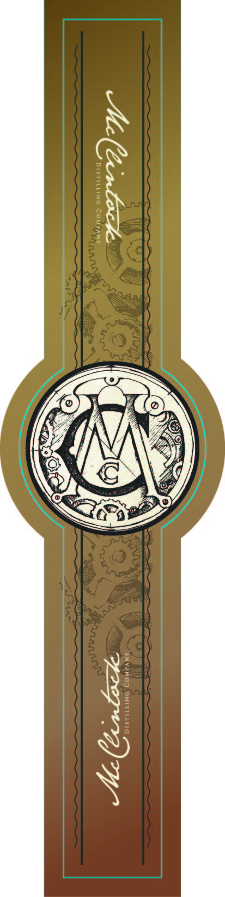

# TTB COLA Label Images - TTBID 26296001000486

**Brand Name:** PATENT NO. 10

**Issue Date:** 10/29/2026

**Origin Code:** 25

**Product Class/Type:** 102

**Source:** [TTB Public COLA Registry](https://ttbonline.gov/colasonline/viewColaDetails.do?action=publicFormDisplay&ttbid=26296001000486)

## Label Images

### Back Label

### Label 3

### Label 4

## Extracted Label Text

*Text extracted via OCR - may contain errors*

*2 image(s) excluded: text did not meet readability threshold*

### Back Label

ICenEzk:
DISTILLING
COMPANY
ATENT N10
STRAIGHT RYE
WHISKEY
TEN YEARS AGO WE SET Out TO MAKE SPIRITS INSPIRED
BY OUR NAMESAKE MCCLINTOCK YoUnG: WITH CURIOSITY,
PATIENCE AND A LOT OF TRIAL AND ERROR. PATENT NO. 10
IS WhAT ThAT DECADE TAUGHT US. IT IS
A STRAIGHT RYE
WHISKEY MADE WITH FINISHED WITH DANKO RYE,
WARTHOG WHEAT AND A TOUch OF DARK MALTED BARLEY,
WHERE BOLD MARYLAND SPICE MEETS
A DEEP; MALTY
FINISH . HERE'$ TO THE NEXT TEN YEARS OF EXPERIMENTS.
DISTILLED AND BOTTLED BY
McCLINTOCK DISTILLING IN FREDERICK MARYLAND
Distiller Signature Goes Here
HEAD DISTILLER:
0
GOVERNMENTWARNING:
ACCORDING To THE
SURGEON GENERAL, WOMEN SHOULD NOT DRINK
ALCOHOLIC BEVERAGES DURING PREGNANCY
2
BECAUSE OF THE RISK OF BIRTH DEFECTS: (2)
CONSUMPTION OF ALCOHOLIC BEVERAGES IMPAIRS
YOUR ABILITY To DRIVE A CAR OR OPERATE
MACHINERY, AND May CAUSE HEALTH PROBLEMS.
